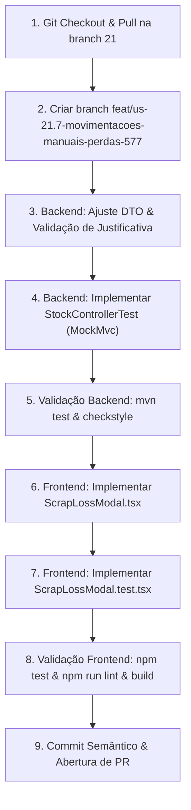

# Plano de Implementação — [US-21.7] Endpoint de Movimentações Manuais & Modal de Perdas/Sucata (#577)

> **Contexto:** Módulo de Estoque e Almoxarifado (`br.edu.ifpb.alumigest.stock` & `frontend/src/features/stock`)  
> **História Pai:** [US-21 #146](https://github.com/ADS-IFPB-SR/alumigest/issues/146) — Reservar e Baixar Matéria-Prima no Estoque Automaticamente  
> **Issue da Tarefa:** [#577](https://github.com/ADS-IFPB-SR/alumigest/issues/577)  
> **Responsável:** Joseph Nichollas (`@josephcavalcante`)  
> **Tipo:** Fullstack (Backend REST + Bean Validation + Frontend React/Modal + Testes MockMvc & Vitest)

---

## 1. 🎯 Objetivo & Visão de Negócio

Disponibilizar o fluxo transacional completo para que a oficina e a fábrica Alumiportas apontem **perdas operacionais, quebras e retalhos descartados (`SCRAP_LOSS`)**, bem como **acertos manuais de contagem de inventário (`MANUAL_ADJUSTMENT`)**:

1. **Rastreabilidade e Kardex Imutável:** Toda perda manual deve registrar imediatamente uma movimentação no Kardex com tipo de movimento, quantidade, saldo anterior, novo saldo, data/hora e justificativa obrigatória.
2. **Blindagem RN-03 (Bloqueio de Saldo Físico Negativo):** Saídas manuais de almoxarifado não podem, sob hipótese alguma, deixar o saldo físico negativo. Caso o operador tente descartar uma quantidade superior ao saldo físico em depósito, a requisição deve ser rejeitada com `BusinessException` (HTTP 422 Unprocessable Entity).
3. **Experiência de Fábrica Elegante (UX/UI):** Um modal reativo, acessível e intuitivo (`ScrapLossModal.tsx`), com validações no formulário em tempo real, bloqueio de submissão inválida, feedback sonoro/visual via toast e invalidação reativa de cache no TanStack Query.

---

## 2. 🗺️ Critérios de Aceitação & Definição de Pronto (DoD)

| ID | Critério de Aceite | Validação Técnica |
| :---: | :--- | :--- |
| **CA-01** | Saídas manuais (`SCRAP_LOSS`) nunca podem deixar o saldo físico negativo. | Lançamento de `BusinessException` com mensagem expressando o saldo insuficiente e resposta HTTP 422. |
| **CA-02** | Justificativa formal é campo **obrigatório** em movimentações extraordinárias. | Validação no DTO/Service rejeitando payload com justificativa nula ou em branco (HTTP 400 ou 422). |
| **CA-03** | Endpoint `POST /api/v1/stock/movements` disponível e documentado no Swagger. | Código de retorno HTTP 201 Created retornando `StockMovementResponseDTO`. |
| **CA-04** | Modal visual `ScrapLossModal.tsx` desenvolvido conforme o Design System AlumiGest. | Componente com seleção de insumo, quantidade, justificativa, suporte a dark mode e WAI-ARIA. |
| **CA-05** | Testes automatizados com 100% de aprovação no backend e frontend. | MockMvc (`StockControllerTest`) + Vitest (`ScrapLossModal.test.tsx`), 0 violações no Checkstyle e 0 erros no Oxlint. |

---

## 3. 🏗️ Arquitetura da Solução

### 3.1 Diagrama de Sequência — Registro de Perda Operacional

```mermaid
sequenceDiagram
    autonumber
    actor Operador as Operador de Oficina
    participant Modal as ScrapLossModal (React)
    participant Hook as useStock (TanStack Query)
    participant API as StockController (REST)
    participant Service as StockService (@Transactional)
    participant Repo as StockItemRepository (@Lock PESSIMISTIC_WRITE)
    participant Domain as StockItem (Domain Entity)
    participant Kardex as StockMovementRepository

    Operador->>Modal: Informa quantidade descartada e justificativa
    Modal->>Modal: Valida campos (qtd > 0, qtd <= físico, justificativa preenchida)
    Operador->>Modal: Clica em "Confirmar Descarte / Perda"
    Modal->>Hook: mutate(StockMovementRequest)
    Hook->>API: POST /api/v1/stock/movements
    API->>API: Valida Bean Validation (@Valid)
    API->>Service: registerMovement(request)
    Service->>Service: Valida obrigatoriedade de justificativa
    Service->>Repo: findByMaterialIdForUpdate(materialId)
    Repo-->>Service: StockItem (bloqueado contra concorrência)
    
    alt Saldo físico insuficiente (quantidade > physical_quantity)
        Service->>Domain: removePhysical(quantity)
        Domain-->>Service: throw BusinessException("Saldo físico insuficiente...")
        Service-->>API: BusinessException
        API-->>Hook: HTTP 422 Unprocessable Entity
        Hook-->>Modal: Toast de erro: "Saldo físico insuficiente..."
    else Saldo físico suficiente
        Service->>Domain: removePhysical(quantity)
        Domain->>Domain: physical -= qty; recalculateAvailable();
        Service->>Repo: saveAndFlush(stockItem)
        Service->>Kardex: save(StockMovement [SCRAP_LOSS])
        Kardex-->>Service: StockMovement gravado
        Service-->>API: StockMovementResponseDTO
        API-->>Hook: HTTP 201 Created
        Hook->>Hook: Invalida ['stock-balances'], ['stock-movements'], ['stock-item']
        Hook-->>Modal: Toast de sucesso
        Modal->>Modal: Fecha modal e reseta formulário
    end
```

---

## 4. 💻 Especificação Técnica Detalhada

### 4.1 Backend (Java / Spring Boot)

#### A. Reforço de Validação no `StockMovementRequestDTO`
Garantir que a justificativa (`reason`) seja formalmente validada para movimentações extraordinárias:

```java
public record StockMovementRequestDTO(
    @NotNull(message = "O ID do material é obrigatório")
    UUID materialId,

    @NotNull(message = "O tipo de movimentação é obrigatório")
    StockMovementType type,

    @NotNull(message = "A quantidade é obrigatória")
    @Positive(message = "A quantidade movimentada deve ser maior que zero")
    BigDecimal quantity,

    BigDecimal unitCost,

    String reason,

    String referenceDocument,

    String registeredBy
) {
    @AssertTrue(message = "A justificativa é obrigatória para perdas e ajustes manuais")
    public boolean isReasonValid() {
        if (type == StockMovementType.SCRAP_LOSS || type == StockMovementType.MANUAL_ADJUSTMENT) {
            return reason != null && !reason.trim().isEmpty();
        }
        return true;
    }
}
```

#### B. Validação Defensiva no `StockService.java`
Reforçar na camada de serviço a obrigatoriedade da justificativa em movimentações manuais:
```java
if ((request.type() == StockMovementType.SCRAP_LOSS || request.type() == StockMovementType.MANUAL_ADJUSTMENT)
        && (request.reason() == null || request.reason().trim().isEmpty())) {
    throw new BusinessException("A justificativa é obrigatória para movimentações de perda ou ajuste manual.");
}
```

#### C. Criação do `StockControllerTest.java` (MockMvc)
Implementar suíte de testes de controlador usando `@WebMvcTest(StockController.class)`:
* `shouldReturn201WhenRegisteringScrapLossSuccessfully`: Valida submissão válida com HTTP 201 Created.
* `shouldReturn422WhenScrapLossExceedsPhysicalQuantity`: Simula `StockService` lançando `BusinessException` e valida status 422 Unprocessable Entity.
* `shouldReturn400WhenQuantityIsNegativeOrZero`: Valida Bean Validation `@Positive`.
* `shouldReturn400WhenScrapLossHasBlankReason`: Valida rejeição quando justificativa for omitida em `SCRAP_LOSS`.

---

### 4.2 Frontend (React / TypeScript / Tailwind CSS)

#### A. Componente `ScrapLossModal.tsx`
* **Localização:** `frontend/src/features/stock/components/ScrapLossModal.tsx`
* **Props da Interface:**
  ```typescript
  export interface ScrapLossModalProps {
    isOpen: boolean;
    onClose: () => void;
    materialId?: string;
    materialSku?: string;
    materialName?: string;
    unitMeasure?: string;
    currentPhysical?: number;
  }
  ```
* **Elementos Visuais e Controles:**
  1. **Header com Badge de Alerta:** Ícone de descarte industrial com destaque em tom Rose/Red (`text-rose-600 bg-rose-50`).
  2. **Banner Informativo do Insumo:** Exibe SKU, Nome e Saldo Físico Atual com destaque para orientar o limite de descarte.
  3. **Campo Quantidade Descartada:** Input numérico com unidade de medida acoplada (`m²`, `barras`, `un`), com validação instantânea (`0 < qtd <= currentPhysical`).
  4. **Seletor Rápido de Motivo de Descarte:** Chips com motivos frequentes:
     * *Quebra / Trinca no Transporte*
     * *Erro de Corte / Usinagem na Bancada*
     * *Retalho / Sobra Inutilizável*
     * *Defeito de Fabricação do Fornecedor*
     * *Outro (especificar abaixo)*
  5. **Campo Justificativa Detalhada (Textarea):** Obrigatório, com contador de caracteres (mínimo 5 caracteres).
  6. **Documento / O.S. Relacionada (Opcional):** Campo para vincular o código da O.S. que originou a perda.
  7. **Botão de Submissão com Estado de Loading:** Desabilitado se o formulário for inválido ou se estiver em processo de mutação.

#### B. Exportação no Barrel
Atualizar `frontend/src/features/stock/components/index.ts` e `frontend/src/features/stock/index.ts` exportando `ScrapLossModal`.

#### C. Testes Unitários Vitest (`ScrapLossModal.test.tsx`)
* Renderização correta quando `isOpen=true` e ocultação quando `isOpen=false`.
* Bloqueio de envio quando quantidade ou justificativa estiverem vazias.
* Exibição de aviso quando a quantidade ultrapassar o saldo físico atual.
* Disparo da mutação `registerMovement` com os dados corretos ao clicar em confirmar.
* Chamada de `onClose` ao clicar no botão cancelar ou no ícone fechar.

---

## 5. 📅 Plano de Execução Passo a Passo



1. **Passo 1 (Git):** Atualizar `feat/us-21-reserva-baixa-estoque` e criar `feat/us-21.7-movimentacoes-manuais-perdas-577`.
2. **Passo 2 (Backend Validation):** Adicionar `@AssertTrue` em `StockMovementRequestDTO` e validação defensiva em `StockService`.
3. **Passo 3 (Backend Test):** Criar `StockControllerTest.java` cobrindo cenários 201, 422 e 400.
4. **Passo 4 (Frontend Modal):** Criar `ScrapLossModal.tsx` com design system oficial AlumiGest e validações.
5. **Passo 5 (Frontend Test):** Criar `ScrapLossModal.test.tsx` com Vitest e React Testing Library.
6. **Passo 6 (Verificação Global):** Executar `./mvnw checkstyle:check test` e `npm run lint && npm test -- --run`.
7. **Passo 7 (Entrega):** Commit semântico vinculando a Issue #577.
