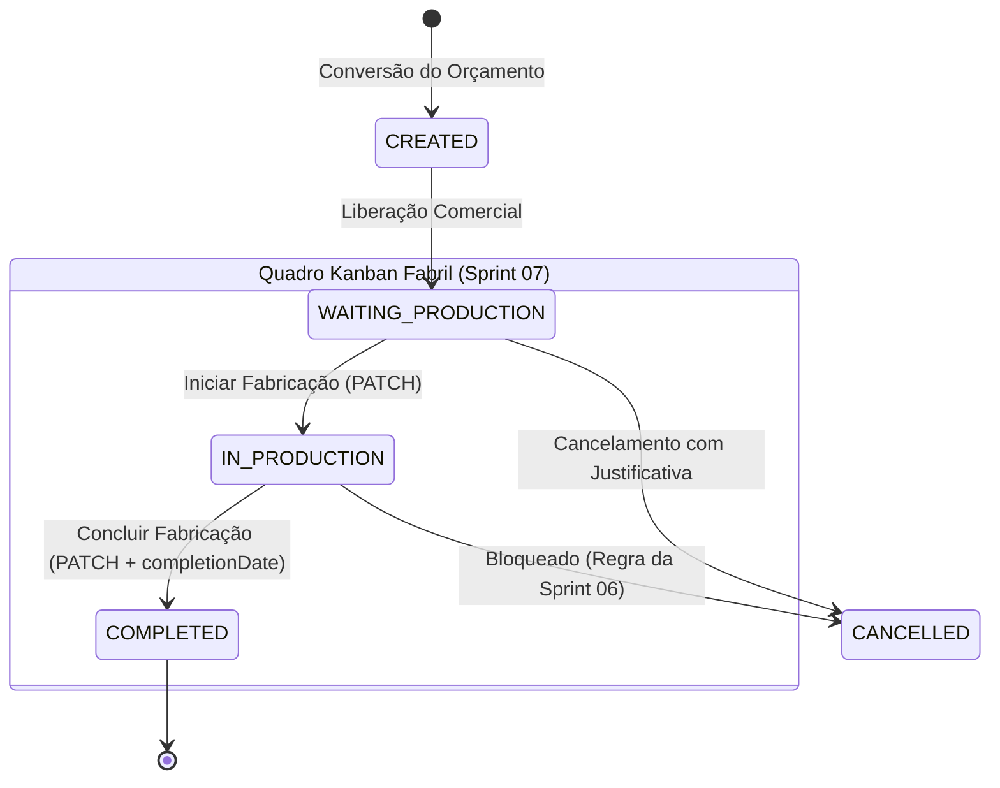

# Data Model: Sprint 07 — Gestão Fabril: Etiquetas de Identificação de Peças & Painel Kanban de Produção

**Feature**: `003-etiquetas-kanban-producao`  
**Período da Sprint 07**: 13/10/2026 a 27/10/2026  
**Status**: APPROVED  
**Requisitos de Schema**: Reutilização integral do schema da tabela `tb_orders` e `tb_order_items` (Migration Flyway `V19__create_orders_schema.sql`). Nenhuma nova migration DDL é necessária nesta sprint, operando sobre colunas e enums em inglês técnico padronizados conforme diretriz de código (`PAD-Padroes_de_Codigo.md`).

---

## 1. Entidades Existentes Utilizadas no Fluxo Fabril

### `Order` (Ordem de Serviço / Pedido de Venda)
Representa a ordem executiva fabril com numeração sequencial anual (`OS-YYYY-NNNN`), aprovada comercialmente, que avança pela esteira de fabricação.

| Coluna (DB) | Atributo Java | Tipo | Nullable | Uso na Sprint 07 |
| :--- | :--- | :--- | :--- | :--- |
| `id` | `id` | `UUID` | NOT NULL | Identificador único da O.S. na rota REST e nos cards |
| `code` | `code` | `VARCHAR(50)` | NOT NULL | Código sequencial impresso na etiqueta e no card do Kanban (ex: `OS-2026-0001`) |
| `customer_name` | `customerName` | `VARCHAR(200)` | NOT NULL | Nome do cliente impresso em destaque na etiqueta e no card |
| `status` | `status` | `VARCHAR(30)` | NOT NULL | Status fabril (`WAITING_PRODUCTION`, `IN_PRODUCTION`, `COMPLETED`) |
| `expected_delivery_date` | `expectedDeliveryDate` | `DATE` | NOT NULL | Cálculo do SLA/urgência de prazo e indicador visual de atraso |
| `completion_date` | `completionDate` | `DATE` | NULL | Preenchida automaticamente pelo backend quando o status transita para `COMPLETED` |
| `notes` | `notes` | `TEXT` | NULL | Observações de oficina/produção exibidas no card |
| `is_active` | `isActive` | `BOOLEAN` | NOT NULL | Filtro de soft delete |

### `OrderItem` (Item da Ordem de Serviço — Snapshot Imutável de Peças)
Cada registro em `tb_order_items` representa um lote de esquadrias contratadas.

| Coluna (DB) | Atributo Java | Tipo | Nullable | Uso na Geração de Etiquetas (`US-17`) |
| :--- | :--- | :--- | :--- | :--- |
| `description` | `description` | `VARCHAR(300)` | NOT NULL | Nome da tipologia impresso na etiqueta (ex: "Janela de Correr 2 Folhas - Linha Gold") |
| `width_mm` | `widthMm` | `INTEGER` | NOT NULL | Largura nominal em mm (`1200 mm`) |
| `height_mm` | `heightMm` | `INTEGER` | NOT NULL | Altura nominal em mm (`1500 mm`) |
| `quantity` | `quantity` | `INTEGER` | NOT NULL | Multiplicador de páginas de etiquetas (se quantidade = 3, gera 3 páginas sequenciais) |
| `aluminum_color` | `aluminumColor` | `VARCHAR(50)` | NULL | Acabamento do perfil (ex: "Preto Anodizado", "Branco") impresso na etiqueta |
| `glass_type` | `glassType` | `VARCHAR(100)` | NULL | Especificação do vidro impresso na etiqueta (ex: "Incolor 6mm Temperado") |
| `opening_direction` | `openingDirection` | `VARCHAR(50)` | NULL | Sentido construtivo impresso na etiqueta |

---

## 2. Máquina de Estados da Produção Fabril

O status da Ordem de Serviço evolui de acordo com o seguinte ciclo estrito com enums em inglês técnico (e tradução vernácula para pt-BR na camada de UI):



### Regras de Transição no Endpoint `PATCH /api/v1/orders/{id}/production-status`:
1. `WAITING_PRODUCTION` ➔ `IN_PRODUCTION`: Permitido. Indica que a O.S. entrou em corte e montagem na oficina.
2. `IN_PRODUCTION` ➔ `COMPLETED`: Permitido. O backend preenche `order.setCompletionDate(LocalDate.now())`.
3. Qualquer outra transição direta (ex: `WAITING_PRODUCTION` ➔ `COMPLETED` ou reabrir ordem `COMPLETED`): Rejeitada com `422 Unprocessable Entity`.
4. Ordens com status `CANCELLED`: Bloqueadas contra qualquer movimentação de produção.

---

## 3. Especificação do Formato Físico da Etiqueta Térmica (100x50 mm)

- **Dimensões em Milímetros**: 100 mm (largura) $\times$ 50 mm (altura) — Proporção 2:1.
- **Dimensões em Pontos OpenPDF (72 DPI)**:
  $$\text{Largura} = \frac{100 \times 72}{25.4} \approx 283.46 \text{ pt}$$
  $$\text{Altura} = \frac{50 \times 72}{25.4} \approx 141.73 \text{ pt}$$
- **Margens**: 3 mm (8.5 pt) para máxima área útil.
- **Filosofia Visual**: Tipografia técnica de alto contraste **sem código de barras** (conforme protótipo `prototipo_etiquetas.html`).
- **Estrutura Visual da Etiqueta**:

```text
+-------------------------------------------------------------+
| AlumiGest ERP                        OS-2026-0002           |
| CLIENTE: JOÃO SILVA                  Item 01 | Peça 01/03   |
+-------------------------------------------------------------+
| Janela de Correr 2 Folhas                           Gold    |
| [=========================================================] |
| |              📐 1200 x 1500 mm                          | |
| [=========================================================] |
| COR: 🎨 Preto Anodizado   | VIDRO: 🪟 Incolor 6mm Temperado |
| LOCAL / OBS: Suíte Master - Bloco A                         |
+-------------------------------------------------------------+
| CÓD: PRD-GOLD-120        | DATA: 12/10/2026 | ALUMIGEST US-17
+-------------------------------------------------------------+
```

---

## 4. DTOs em Inglês Técnico (Records Java 21)

```java
// Requisição de transição de status fabril
public record OrderProductionStatusRequestDTO(
    @NotNull(message = "O novo status de produção é obrigatório")
    OrderStatus status
) {}

// Resumo simplificado de item para o card Kanban
public record OrderItemSummaryResponseDTO(
    UUID id,
    String description,
    Integer quantity,
    Integer widthMm,
    Integer heightMm,
    String aluminumColor,
    String glassType
) {}

// Card de exibição no Kanban
public record OrderProductionCardResponseDTO(
    UUID id,
    String code,
    String customerName,
    LocalDate expectedDeliveryDate,
    LocalDate completionDate,
    OrderStatus status,
    Integer totalPieces,
    Long daysRemaining,
    boolean isDelayed,
    List<OrderItemSummaryResponseDTO> items
) {}
```
