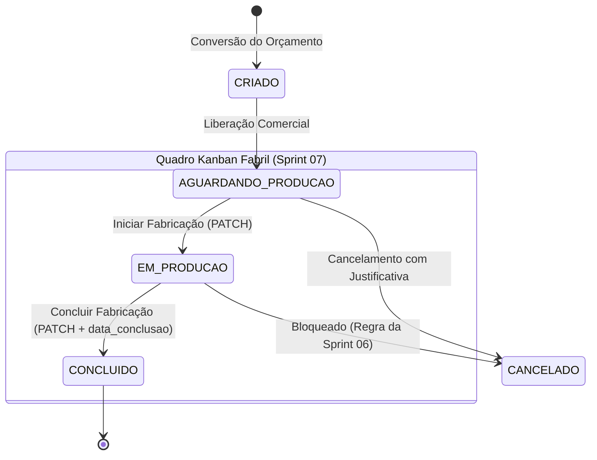

# Data Model: Sprint 07 — Gestão Fabril: Etiquetas de Identificação de Peças & Painel Kanban de Produção

**Feature**: `003-etiquetas-kanban-producao`  
**Período da Sprint 07**: 13/10/2026 a 27/10/2026  
**Status**: APPROVED  
**Requisitos de Schema**: Reutilização integral do schema da tabela `tb_orders` e `tb_order_items` (Migration Flyway `V19__create_orders_schema.sql`). Nenhuma nova migration DDL é necessária nesta sprint, operando sobre colunas e enums existentes.

---

## 1. Entidades Existentes Utilizadas no Fluxo Fabril

### `Order` (Pedido de Venda)
Representa a ordem comercial aprovada que avança pela esteira de fabricação.

| Campo | Tipo | Nullable | Uso na Sprint 07 |
| :--- | :--- | :--- | :--- |
| `id` | `UUID` | NOT NULL | Identificador único do pedido na rota REST e nos cards |
| `codigo` | `VARCHAR(20)` | NOT NULL | Código sequencial impresso na etiqueta e exibido no card do Kanban (ex: `PED-2026-0001`) |
| `cliente_nome` | `VARCHAR(200)` | NOT NULL | Nome do cliente impresso em destaque na etiqueta e no card |
| `status` | `VARCHAR(25)` | NOT NULL | Coluna do Kanban (`AGUARDANDO_PRODUCAO`, `EM_PRODUCAO`, `CONCLUIDO`) |
| `data_previsao_entrega` | `DATE` | NOT NULL | Cálculo do SLA/urgência de prazo e indicador visual de atraso |
| `data_conclusao` | `DATE` | NULL | Preenchida automaticamente pelo backend quando o status transita para `CONCLUIDO` |
| `observacoes` | `TEXT` | NULL | Observações de oficina/produção exibidas no card |
| `ativo` | `BOOLEAN` | NOT NULL | Filtro de soft delete |

### `OrderItem` (Item do Pedido de Venda — Snapshot de Peças)
Cada registro em `tb_order_items` representa um lote de esquadrias contratadas.

| Campo | Tipo | Nullable | Uso na Geração de Etiquetas (`US-17`) |
| :--- | :--- | :--- | :--- |
| `descricao` | `VARCHAR(300)` | NOT NULL | Nome da tipologia impresso na etiqueta (ex: "Janela 2 Folhas Linha Suprema") |
| `largura_mm` | `INTEGER` | NOT NULL | Largura nominal em mm (`L: 1200 mm`) |
| `altura_mm` | `INTEGER` | NOT NULL | Altura nominal em mm (`A: 1000 mm`) |
| `quantidade` | `INTEGER` | NOT NULL | Multiplicador de páginas de etiquetas (se quantidade = 3, gera 3 páginas sequenciais) |
| `cor_aluminio` | `VARCHAR(50)` | NULL | Acabamento do perfil (ex: "Branco", "Preto Fosco") impresso na etiqueta |
| `tipo_vidro` | `VARCHAR(100)` | NULL | Especificação do vidro impresso na etiqueta |
| `orientacao_abertura` | `VARCHAR(30)` | NULL | Sentido construtivo impresso na etiqueta |

---

## 2. Máquina de Estados da Produção Fabril

O status do pedido evolui de acordo com o seguinte ciclo estrito:



### Regras de Transição no Endpoint `PATCH /api/orders/{id}/production-status`:
1. `AGUARDANDO_PRODUCAO` ➔ `EM_PRODUCAO`: Permitido. Indica que o pedido entrou em corte e montagem na oficina.
2. `EM_PRODUCAO` ➔ `CONCLUIDO`: Permitido. O backend preenche `order.setDataConclusao(LocalDate.now())`.
3. Qualquer outra transição direta (ex: `AGUARDANDO_PRODUCAO` ➔ `CONCLUIDO` ou reabrir pedido `CONCLUIDO`): Rejeitada com `422 Unprocessable Entity`.
4. Pedidos com status `CANCELADO`: Bloqueados contra qualquer movimentação de produção.

---

## 3. Especificação do Formato Físico da Etiqueta Térmica (100x50 mm)

- **Dimensões em Milímetros**: 100 mm (largura) $\times$ 50 mm (altura).
- **Dimensões em Pontos OpenPDF (72 DPI)**:
  $$\text{Largura} = \frac{100 \times 72}{25.4} \approx 283.46 \text{ pt}$$
  $$\text{Altura} = \frac{50 \times 72}{25.4} \approx 141.73 \text{ pt}$$
- **Margens**: 10 pt em todas as bordas para máxima área útil.
- **Estrutura Visual da Etiqueta**:

```text
+-------------------------------------------------------------+
| ALUMIPORTAS                         PED-2026-0001           |
| Cliente: João da Silva Sauro        Entrega: 25/10/2026     |
+-------------------------------------------------------------+
| Item: Janela 2 Folhas Móveis - Suprema                      |
| MEDIDAS: 1200 x 1000 mm                                     |
| Perfil: Branco             | Vidro: Incolor 4mm             |
| Abertura: Direita          | Peça: 1 de 3                   |
+-------------------------------------------------------------+
```

---

## 4. DTOs (Records Java 21)

```java
// Requisição de transição de status fabril
public record ProductionStatusUpdateRequest(
    @NotNull(message = "O novo status de produção é obrigatório")
    OrderStatus status
) {}

// Resumo simplificado de item para o card Kanban
public record OrderItemSummaryResponse(
    UUID id,
    String descricao,
    Integer quantidade,
    Integer larguraMm,
    Integer alturaMm
) {}

// Card de exibição no Kanban
public record OrderProductionCardResponse(
    UUID id,
    String codigo,
    String clienteNome,
    LocalDate dataPrevisaoEntrega,
    LocalDate dataConclusao,
    OrderStatus status,
    Integer totalPecas,
    Long diasRestantes,
    boolean atrasado,
    List<OrderItemSummaryResponse> itens
) {}
```
