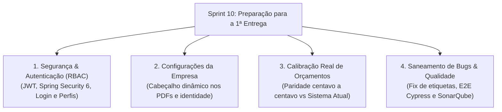

# 📌 Sprint 10 — Autenticação & RBAC, Configurações Institucionais e Calibração Real para a 1ª Entrega

**Período Oficial da Sprint 10**: 24/11/2026 a 07/12/2026  
**Status**: 🟢 Planejada  
**Product Owner (PO)**: José Guylherme dos Santos Melo  
**Scrum Master**: Júlio Kennedy dos Santos Silva  
**Equipe de Desenvolvimento**: Guilherme Kauã, Italo Jefferson, Joseph Nichollas, Júlio Kennedy, Herbert Carvalho, Gabriel de Souza (6 desenvolvedores)  
**Escopo Oficial Aprovado**: Preparação e Blindagem para a **Primeira Entrega Oficial (Release 2)**  

Esta pasta contém o pacote de engenharia da **Sprint 10** do projeto **AlumiGest**, estruturado estrategicamente como a **sprint de estabilização, segurança web, parametrização institucional e prova de paridade real** para a Primeira Grande Entrega do sistema.

Todo o planejamento foi decomposto estritamente em **Fatias Atômicas (*Atomic Slices*) de até 3.5 horas** em conformidade com o [`guia-estimativa-horas.md`](../guia-estimativa-horas.md) e com o dimensionamento de **14 Story Points** (~41.0 horas de engenharia no total, correspondendo a ~7.0h por desenvolvedor).

---

## 🎯 Os 4 Pilares Estratégicos da Sprint 10

### 1. Sistema de Login, Autenticação e Controle de Acesso (RBAC)
Como a aplicação é web, a segurança e a rastreabilidade de quem opera o sistema são requisitos primordiais para a entrega:
- **Controle de Acesso Baseado em Perfis (RBAC)**:
  - `ADMIN`: Gestão geral, configurações institucionais da empresa, catálogo e relatórios.
  - `VENDEDOR`: Criação de orçamentos, cadastro de clientes, venda avulsa e conversão em O.S.
  - `OPERADOR`: Acesso restrito ao Painel Kanban de Produção, emissão de etiquetas térmicas, fichas técnicas de montagem/corte e apontamento de perdas/sucata.
- **Autenticação Segura JWT**: Senhas criptografadas com `BCryptPasswordEncoder`, tokens assinados via HMAC-SHA256 e interceptor de requisições no frontend.
- **Experiência Visual**: Tela de login limpa, responsiva e com feedback reativo de erro e bloqueio de rotas não autorizadas (`ProtectedRoute`).

### 2. Painel de Configurações da Empresa & Cabeçalho Dinâmico
Eliminação de dados estáticos (*hardcoded*) de configuração, permitindo ao dono da vidraçaria/serralheria personalizar sua empresa:
- Cadastro e persistência de: **Razão Social, Nome Fantasia, CNPJ, Inscrição Estadual, Telefone/WhatsApp, Endereço, Cidade-UF e Logotipo**.
- **Reflexo Dinâmico Imediato**: Todos os documentos gerados pelo sistema (Orçamentos comerciais em PDF, Fichas Técnicas A4 de montagem/corte, Comprovantes de O.S., Vendas Avulsas e Etiquetas Térmicas 100×60mm) passam a renderizar o cabeçalho oficial dinamicamente a partir do banco de dados.

### 3. Calibração e Prova de Paridade com Orçamentos Reais da Alumiportas
A prova de fogo da confiabilidade do motor de precificação e cálculo paramétrico:
- Simulação e confronto de **5 esquadrias padrão reais** produzidas na oficina da Alumiportas (Janelas 2F e 4F Suprema, Porta Pivotante Gold, Maxim-ar e Janela Integrada).
- Comparativo direto: **[Sistema Atual / Planilha da Empresa]** vs **[AlumiGest]**.
- Validação milimétrica de:
  - Fórmulas lineares de corte de perfis ($4W + 6H$, montantes, travessas e folgas);
  - Área líquida de vidro ($m^2$);
  - Rateio de ferragens, roldanas e escovas de vedação;
  - Custo de mão de obra e preço final de venda.
- Ajuste fino dos motores (`DefaultFrameCalculator`, `SupremaSlidingWindowCalculator`) garantindo **paridade com margem de divergência R$ 0,00**.

### 4. Saneamento Completo de Bugs & Quality Gate Verde
Estabilidade absoluta para a banca e para o cliente final:
- Finalização da correção da impressão de etiquetas térmicas na Venda Avulsa (Issue [#598](https://github.com/ADS-IFPB-SR/alumigest/issues/598) / PR [#600](https://github.com/ADS-IFPB-SR/alumigest/pull/600)).
- Bateria completa de testes automatizados: MockMvc no backend, Vitest no frontend e suíte Cypress E2E.
- SonarQube com **Quality Gate 100% aprovado**, 0 bugs, 0 vulnerabilidades e 0 code smells.

---

## 🗺️ Mapa de Fatiamento Atômico (Sprint Backlog)

| Sub-Task | Título da Tarefa Atômica | Escopo Delimitado & Critérios Técnicos | Story Points | Horas Estimadas |
|:---:|---|---|:---:|:---:|
| **US-10.1** | **Setup de Autenticação, Entidade `User` e Migração Flyway `V27`** | Script `V27__create_users_schema.sql`, entidade `User`, enum `UserRole` (`ADMIN`, `VENDEDOR`, `OPERADOR`), `UserRepository` e hash BCrypt. | 1 pt | 2.5h |
| **US-10.2** | **Motor de Autenticação JWT, Spring Security 6 e Endpoints `/api/v1/auth`** | `SecurityConfig`, `JwtService`, filtro `JwtAuthenticationFilter`, DTOs de login e endpoints `/api/v1/auth/login` e `/api/v1/auth/me`. | 2 pts | 3.5h |
| **US-10.3** | **Tela de Login (`/login`) Responsiva e Interceptor no Frontend** | Página de login com Design System oficial, validação Zod/React Hook Form, `authApi.ts`, armazenamento seguro de token e feedback toast. | 2 pts | 3.5h |
| **US-10.4** | **Controle de Acesso RBAC, `ProtectedRoute` e Logout no Frontend** | Componente `ProtectedRoute.tsx`, bloqueio por role, exibição do usuário ativo no cabeçalho e ação de logout. | 1 pt | 2.5h |
| **US-10.5** | **Entidade `CompanySettings`, Migração `V28` e Endpoints de Configurações** | Tabela `tb_company_settings`, entidade singleton, DTOs e endpoints `GET` / `PUT /api/v1/settings/company` com validação de CNPJ/Telefone. | 1 pt | 2.5h |
| **US-10.6** | **Tela de Configurações (`/configuracoes`) com Preview de Cabeçalho** | Substituição do Placeholder por formulário de configurações com preview interativo do cabeçalho institucional em tempo real. | 2 pts | 3.5h |
| **US-10.7** | **Consumo Dinâmico dos Dados da Empresa em todos os PDFs e Etiquetas** | Refatoração de `BudgetPdfService`, `OrderReceiptPdfService`, `ProductionSheetService`, `PartSalePdfService` e `LabelPdfService` para lerem do banco. | 1 pt | 3.0h |
| **US-10.8** | **Matriz de Calibração com 5 Casos Reais de Esquadrias da Alumiportas** | Roteiro de benchmarking, carga de dados reais e comparativo detalhado de medidas e custos vs planilha da oficina. | 1 pt | 2.5h |
| **US-10.9** | **Ajuste Fino dos Motores de Cálculo para Paridade Centavo a Centavo** | Calibração de folgas de corte e fórmulas em `SupremaSlidingWindowCalculator` e `DefaultFrameCalculator`, validando divergência R$ 0,00. | 1 pt | 3.5h |
| **US-10.10** | **Saneamento do Bug de Etiquetas Térmicas na Venda Avulsa (PR #600)** | Integração do endpoint oficial de PDF de etiquetas térmicas 100×60mm na Venda Avulsa e fechamento da Issue #598. | 1 pt | 2.5h |
| **US-10.11** | **Bateria E2E Cypress, Quality Gate SonarQube e Dossiê de Homologação** | Execução da suíte Cypress de ponta a ponta, validação no Coolify e geração dos documentos de aceitação (`TEA`, `RTM`, `RET`). | 1 pt | 3.5h |
| **Total** | **11 Tarefas Atômicas ($\le$ 3.5h cada)** | **Cobertura Completa dos 4 Pilares da Sprint 10** | **14 pts** | **37.0h** |

---

## 📊 Resumo Executivo da Sprint 10

| Indicador | Total Planejado |
|---|:---:|
| **Histórias / Pilares Contemplados** | **4 Pilares Estratégicos** (Segurança, Configurações, Calibração, Qualidade) |
| **Total de Tarefas da Sprint** | **11 Tarefas Atômicas** |
| **Total de Story Points** | **14 pts** |
| **Total de Horas de Engenharia** | **37.0 horas** |
| **Carga Média por Desenvolvedor** | ~6.2 horas (2 tarefas atômicas por desenvolvedor) |

---

## 🔗 Documentos de Apoio e Protótipos

- 📑 **Especificação Funcional Detalhada da Sprint 10**: [`spec.md`](spec.md)
- 🖥️ **Protótipo Interativo Homologado da Sprint 10**: [`docs/planejamento/prototipos/autenticacao-configuracoes-homologacao.html`](../prototipos/autenticacao-configuracoes-homologacao.html)
- 🏛️ **Constituição e Padrões de Projeto**: [`constitution.md`](../constitution.md)
