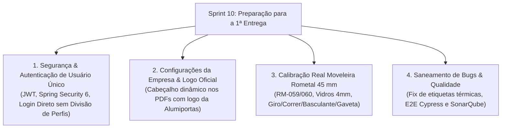

# 📌 Sprint 10 — Autenticação de Usuário Único, Configurações Institucionais e Calibração Moveleira Rometal 45 mm para a 1ª Entrega

**Período Oficial da Sprint 10**: 24/11/2026 a 07/12/2026  
**Status**: 🟢 Planejada e Calibrada com o Parceiro Social (Alumiportas)  
**Product Owner (PO)**: José Guylherme dos Santos Melo  
**Scrum Master**: Júlio Kennedy dos Santos Silva  
**Equipe de Desenvolvimento**: Guilherme Kauã, Italo Jefferson, Joseph Nichollas, Júlio Kennedy, Herbert Carvalho, Gabriel de Souza (6 desenvolvedores)  
**Escopo Oficial Aprovado**: Preparação e Blindagem para a **Primeira Entrega Oficial (Release 2)**  

Esta pasta contém o pacote de engenharia da **Sprint 10** do projeto **AlumiGest**, estruturado estrategicamente como a **sprint de estabilização, segurança web, parametrização institucional e prova de paridade real moveleira** para a Primeira Grande Entrega do sistema.

Todo o planejamento foi decomposto estritamente em **Fatias Atômicas (*Atomic Slices*) de até 3.5 horas** em conformidade com o [`guia-estimativa-horas.md`](../guia-estimativa-horas.md) e com o dimensionamento de **12 Story Points** (~29.0 horas de engenharia no total, correspondendo a ~5.0h por desenvolvedor).

---

## 🎯 Os 4 Pilares Estratégicos da Sprint 10

### 1. Sistema de Login & Autenticação de Usuário Único
Como a aplicação é web, a proteção contra acessos indevidos é essencial para a entrega comercial:
- **Usuário Único / Administrador da Oficina**: O sistema atende à oficina Alumiportas com operador único, eliminando a complexidade desnecessária de segregação em 3 categorias de perfil (`ADMIN`, `VENDEDOR`, `OPERADOR`).
- **Autenticação Segura JWT**: Senhas criptografadas com `BCryptPasswordEncoder`, tokens assinados via HMAC-SHA256 e interceptor de requisições no frontend.
- **Experiência Visual**: Tela de login limpa, elegante, responsiva e com feedback reativo de erro e proteção universal de rotas privadas (`ProtectedRoute`).

### 2. Painel de Configurações da Empresa & Cabeçalho Dinâmico
Eliminação de dados estáticos (*hardcoded*), permitindo à oficina personalizar seus dados cadastrais mantendo a identidade visual oficial:
- **Logotipo Oficial**: O sistema já possui o logotipo oficial da empresa (`logo-alumiportas.png`), utilizado de forma consistente no cabeçalho.
- **Cadastro e Persistência Dinâmica**: **Razão Social, Nome Fantasia, CNPJ, Inscrição Estadual, Telefone/WhatsApp, Endereço e Cidade-UF**.
- **Reflexo Dinâmico Imediato**: Todos os documentos gerados pelo sistema (Orçamentos comerciais em PDF, Fichas Técnicas A4 de montagem/corte, Comprovantes de O.S., Vendas Avulsas e Etiquetas Térmicas 100×60mm) passam a renderizar o cabeçalho oficial dinamicamente a partir do banco de dados.

### 3. Calibração e Prova de Paridade com a Linha 45 mm Rometal Moveleira
A prova de fogo da confiabilidade do motor de precificação e engenharia no core business da empresa:
- **Foco Real: Ramo Moveleiro de Alto Padrão**: Portas e gavetas em alumínio com vidro de 4mm para móveis planejados, armários e closets.
- **Perfis de Alumínio Moveleiro Rometal 45 mm**:
  - **RM-060**: Perfil estrutural 45mm com **aba frontal baixa** (estética limpa/minimalista).
  - **RM-059**: Perfil estrutural 45mm com **aba frontal alta** (visual robusto com sobreposição).
- **Cores Homologadas**: **Bronze** (Anodizado Bronze), **Fosco** (Anodizado Fosco / Jateado) e **Preto** (Preto Fosco).
- **Vidros Utilizados**: Estritamente **Vidro 4 mm** (Incolor, Reflecta Bronze, Reflecta Fumê, Espelho Prata 4mm, Acidato).
- **4 Tipologias Moveleiras do Benchmark de Paridade**:
  1. **Porta de Giro Moveleira 45mm** ($2100 \times 450\text{ mm}$, RM-060 Preto, Reflecta Bronze 4mm, dobradiças 45mm);
  2. **Porta de Correr Moveleira 45mm** ($2200 \times 800\text{ mm}$, RM-059 Fosco, Espelho 4mm, roldanas deslizantes Rometal);
  3. **Porta Basculante Moveleira 45mm** ($400 \times 900\text{ mm}$, RM-060 Bronze, Vidro 4mm, pistões a gás 80N);
  4. **Frente de Gaveta Moveleira 45mm** ($180 \times 600\text{ mm}$, RM-060 Preto, Vidro 4mm, cantoneiras de corrediça).
- **Meta Matemática**: Divergência $\Delta = \text{R\$} 0{,}00$ entre o cálculo do AlumiGest e as planilhas da Alumiportas.

### 4. Saneamento Completo de Bugs & Quality Gate Verde
Estabilidade absoluta para a banca e para o cliente final:
- Finalização da correção da impressão de etiquetas térmicas na Venda Avulsa (Issue [#598](https://github.com/ADS-IFPB-SR/alumigest/issues/598) / PR [#600](https://github.com/ADS-IFPB-SR/alumigest/pull/600)).
- Bateria completa de testes automatizados: MockMvc no backend, Vitest no frontend e suíte Cypress E2E.
- SonarQube com **Quality Gate 100% aprovado**, 0 bugs, 0 vulnerabilidades e 0 code smells.

---

## 🗺️ Mapa de Fatiamento Atômico (Sprint Backlog)

| Sub-Task | Título da Tarefa Atômica | Escopo Delimitado & Critérios Técnicos | Story Points | Horas Estimadas |
|:---:|---|---|:---:|:---:|
| **US-10.1** | **Setup de Autenticação, Entidade `User` e Migração Flyway `V27`** | Script `V27__create_users_schema.sql`, tabela `tb_users` (usuário único admin), entidade `User`, `UserRepository` e hash BCrypt. | 1 pt | 2.0h |
| **US-10.2** | **Motor de Autenticação JWT, Spring Security 6 e Endpoints `/api/v1/auth`** | `SecurityConfig` stateless, `JwtService`, filtro `JwtAuthenticationFilter`, DTOs de login e endpoints `/api/v1/auth/login` e `/api/v1/auth/me`. | 2 pts | 3.0h |
| **US-10.3** | **Tela de Login (`/login`) e Proteção de Rotas (`ProtectedRoute`) no Frontend** | Página de login com Design System oficial e logotipo Alumiportas, validação Zod/React Hook Form, `ProtectedRoute` e botão Logout. | 2 pts | 3.0h |
| **US-10.4** | **Entidade `CompanySettings`, Migração `V28` e Endpoints de Configurações** | Tabela `tb_company_settings`, entidade singleton, DTOs e endpoints `GET` / `PUT /api/v1/settings/company` com validação de CNPJ/Telefone. | 1 pt | 2.0h |
| **US-10.5** | **Tela de Configurações (`/configuracoes`) com Preview de Cabeçalho A4** | Substituição do Placeholder por formulário com exibição da logomarca oficial e preview interativo do cabeçalho institucional em tempo real. | 2 pts | 3.0h |
| **US-10.6** | **Consumo Dinâmico dos Dados da Empresa em todos os PDFs e Etiquetas** | Refatoração de `BudgetPdfService`, `OrderReceiptPdfService`, `ProductionSheetPdfService`, `PartSalePdfService` e `LabelPdfService` para lerem do banco. | 1 pt | 2.5h |
| **US-10.7** | **Matriz de Calibração das 4 Tipologias Moveleiras Rometal 45 mm** | Levantamento de fórmulas de corte e insumos para Portas de Giro, Correr, Basculante e Frente de Gaveta (RM-059/060 Bronze, Fosco, Preto, Vidro 4mm). | 1 pt | 2.5h |
| **US-10.8** | **Ajuste Fino dos Motores de Cálculo para Paridade Centavo a Centavo** | Calibração de folgas de esquadria 45°, desconto de vidro 4mm e acessórios (ESQ-041, BG-216), com testes unitários comprovando $\Delta = \text{R\$} 0{,}00$. | 1 pt | 3.0h |
| **US-10.9** | **Saneamento do Bug de Etiquetas Térmicas na Venda Avulsa (PR #600)** | Integração do endpoint oficial de PDF de etiquetas térmicas 100×60mm na Venda Avulsa e fechamento da Issue #598. | 1 pt | 2.5h |
| **US-10.10** | **Bateria E2E Cypress, Quality Gate SonarQube e Dossiê de Homologação** | Execução da suíte Cypress de ponta a ponta, validação no Coolify e geração dos documentos de aceitação (`TEA`, `RTM`, `RET`). | 1 pt | 3.0h |
| **Total** | **10 Tarefas Atômicas ($\le$ 3.5h cada)** | **Cobertura Completa dos 4 Pilares da Sprint 10** | **13 pts** | **26.5h** |

---

## 📊 Resumo Executivo da Sprint 10

| Indicador | Total Planejado |
|---|:---:|
| **Histórias / Pilares Contemplados** | **4 Pilares Estratégicos** (Segurança, Configurações, Calibração Moveleira, Qualidade) |
| **Total de Tarefas da Sprint** | **10 Tarefas Atômicas** |
| **Total de Story Points** | **13 pts** |
| **Total de Horas de Engenharia** | **26.5 horas** |
| **Carga Média por Desenvolvedor** | ~4.4 horas (menos de 2 fatias por desenvolvedor) |

---

## 🔗 Documentos de Apoio e Protótipos

- 📑 **Especificação Funcional Detalhada da Sprint 10**: [`spec.md`](spec.md)
- 🖥️ **Protótipo Interativo Homologado da Sprint 10**: [`docs/planejamento/prototipos/autenticacao-configuracoes-homologacao.html`](../prototipos/autenticacao-configuracoes-homologacao.html)
- 🏛️ **Constituição e Padrões de Projeto**: [`constitution.md`](../constitution.md)
