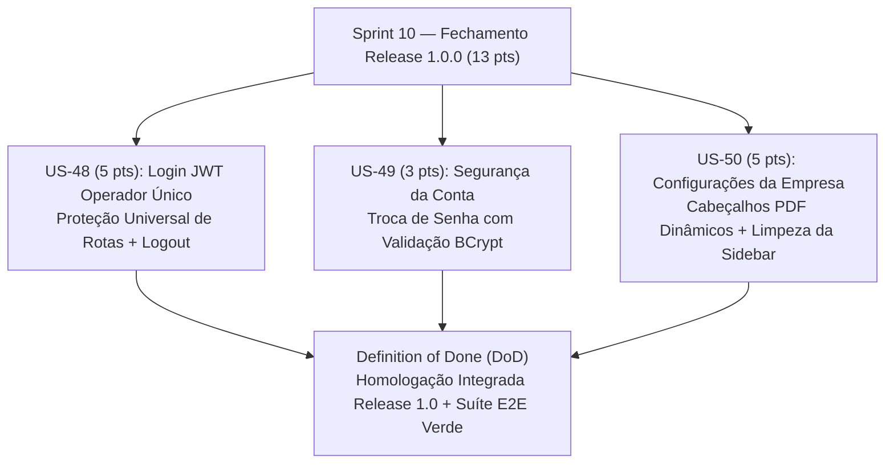

# 📌 Sprint 10 — Autenticação JWT (Operador Único), Segurança da Conta, Configurações Institucionais & Homologação Release 1.0 (DoD)

**Período Oficial da Sprint 10**: 24/11/2026 a 07/12/2026  
**Status**: 🟢 Planejada e Alinhada com o Product Owner  
**Marco de Entrega**: 🏆 **Release 1.0.0 (Sistema Protegido, Parametrizado e Homologado)**  
**Product Owner (PO)**: José Guylherme dos Santos Melo  
**Scrum Master**: Joseph Nichollas Abreu Cavalcante  
**Equipe de Desenvolvimento**: Guilherme Kauã, Herbert Carvalho, Ítalo Jefferson, José Guylherme, Joseph Nichollas, Júlio Kennedy, Maylson Rodrigues  
**Escopo Oficial Aprovado**: **`US-48`**, **`US-49`** e **`US-50`** *(com Homologação da Release 1.0 incorporada no Definition of Done)*  

Esta pasta contém o pacote oficial de engenharia da **Sprint 10** do projeto **AlumiGest**, decomposto estritamente em **Fatias Verticais Atômicas (*Atomic Slices*) de até 3.0 horas** em conformidade com o [`guia-estimativa-horas.md`](../guia-estimativa-horas.md) e dimensionado em **13 Story Points** (**25.0 horas** totais de engenharia):
- **US-48**: Autenticar Operador Único com JWT, Proteger Rotas Privadas e Encerrar Sessão (Issue [#610](https://github.com/ADS-IFPB-SR/alumigest/issues/610)) — **5 Story Points** (~8.5h).
- **US-49**: Alterar Senha de Acesso da Conta Autenticada (Issue [#611](https://github.com/ADS-IFPB-SR/alumigest/issues/611)) — **3 Story Points** (~5.5h).
- **US-50**: Configurar Dados Institucionais da Empresa, Atualizar Cabeçalhos PDF e Higienizar UI da Release 1.0 (Issue [#612](https://github.com/ADS-IFPB-SR/alumigest/issues/612)) — **5 Story Points** (~11.0h).

---

## 🎯 Sprint Goal (Meta da Sprint 10)

> *"Proteger o AlumiGest ERP para operação web real com autenticação JWT de operador único e gestão segura da própria senha, parametrizar os dados institucionais da empresa nos documentos gerados sob demanda e higienizar a navegação removendo funcionalidades não concluídas, consolidando a homologação da Release 1.0.0 no Definition of Done."*

---

## 🤝 Diretrizes de Produto & Decisões Arquiteturais (Zero Regressão)

### 1. Operador Único Autenticado (Sem RBAC em 3 Perfis e Sem Auto-Cadastro)
Por decisão explícita de negócio junto ao Product Owner para a Release 1.0:
- **Apenas 1 perfil autenticado** (Operador Único / Administrador da Oficina), sem divisão em 3 categorias (`ADMIN`, `SELLER`, `PRODUCTION`) e sem matriz de permissões por papel nesta entrega.
- **Sem sistema de registro de contas na interface**: não há tela pública de auto-cadastro nem CRUD de múltiplos usuários; a conta oficial nasce provisionada via *seed* (`V27__create_users_schema.sql` / variáveis de ambiente) com hash `BCrypt`.
- **Bloqueio de 15 min após 5 falhas (`RF-005`) e Log de Auditoria (`RF-006`)** permanecem postergados para evoluções futuras.

### 2. Troca Segura da Própria Senha na Interface (`US-49`)
- O operador autenticado pode substituir a senha inicial diretamente em `/configuracoes`, informando obrigatoriamente a `Senha Atual`, a `Nova Senha` ($\ge 8$ caracteres, distinta da atual) e a confirmação.

### 3. Parametrização Institucional em Banco Substituindo Dados Estáticos (`US-50`)
- Substitui os valores estáticos hoje lidos apenas de `CompanyProperties` (`@ConfigurationProperties(prefix = "empresa")`) por persistência dinâmica singleton em `tb_company_settings` (`V28__create_company_settings_schema.sql`), mantendo fallback seguro.
- **Sem upload de imagem**: preserva a logomarca institucional já embarcada em `backend/src/main/resources/static/logo-alumiportas.png`.
- **Sem reprocessamento retroativo de PDFs**: alterações cadastrais refletem naturalmente nas emissões sob demanda realizadas a partir do salvamento, preservando o *snapshot* imutável dos pedidos aprovados (`US-14`).

### 4. Higienização de Navegação & Blindagem dos 2.120 Testes Existentes
- **UI Limpa para a Release 1.0**: ocultação dos menus *placeholder* não concluídos (`Dashboard` e `Financeiro` na `Sidebar.tsx`) e remoção de elementos estáticos mortos na `Topbar.tsx`.
- **Compatibilidade Automatizada**: suporte `@WithMockUser` para testes legados de fatia WebMvc no backend e comando `cy.login()` com cache `cy.session()` no Cypress.
- **Homologação como DoD**: em aderência ao histórico do projeto (`de-para-user-stories.md`), a homologação ponta a ponta da Release 1.0 integra o **Definition of Done** da sprint.

---

## 🗺️ Mapa de Histórias e Fatiamento Atômico (Sprint Backlog)

### 🔐 US-48: Autenticar Operador Único com JWT, Proteger Rotas Privadas e Encerrar Sessão
**Issue GitHub**: [#610](https://github.com/ADS-IFPB-SR/alumigest/issues/610) | **Prioridade**: P1 (Bloqueante Release 1.0)  
**Branch Base**: `develop` | **Branch de Feature**: `feat/us-48-autenticacao-jwt`

| Sub-Task | Issue GitHub | Título da Tarefa Atômica | Escopo Técnico Delimitado (BD + Back + Front + QA) | Story Points | Horas Estimadas |
|:---:|:---:|---|---|:---:|:---:|
| **US-48.1** | [#613](https://github.com/ADS-IFPB-SR/alumigest/issues/613) | **Migration `V27`, Entidade `User` (Operador Único) e `JwtService`** | Script `V27__create_users_schema.sql` com *seed* inicial `BCrypt`, entidade JPA `User`, `UserRepository` e geração/validação JWT HMAC-SHA256 (8h) + testes unitários. | 1 pt | 2.5h |
| **US-48.2** | [#614](https://github.com/ADS-IFPB-SR/alumigest/issues/614) | **Spring Security 6 Stateless, Endpoints `/api/v1/auth` e Compatibilidade de Testes** | `SecurityConfig`, `JwtAuthenticationFilter`, `POST /api/v1/auth/login`, `GET /api/v1/auth/me` e suporte `@WithMockUser` para testes MockMvc legados. | 2 pts | 3.0h |
| **US-48.3** | [#615](https://github.com/ADS-IFPB-SR/alumigest/issues/615) | **Tela `/login`, `ProtectedRoute`, Sessão Axios e Logout Real** | `LoginPage.tsx` (M3 Light/Dark), `AuthContext`, interceptor Axios `Bearer`/401, guarda universal de rotas privadas, nome real na `Topbar` e ação `Sair` + Vitest. | 2 pts | 3.0h |
| **Subtotal US-48** | — | — | **3 Tarefas Atômicas ($\le$ 3.0h cada)** | **5 pts** | **8.5h** |

---

### 🔑 US-49: Alterar Senha de Acesso da Conta Autenticada
**Issue GitHub**: [#611](https://github.com/ADS-IFPB-SR/alumigest/issues/611) | **Prioridade**: P1 (Segurança Operacional)  
**Branch Base**: `develop` | **Branch de Feature**: `feat/us-49-alteracao-senha`

| Sub-Task | Issue GitHub | Título da Tarefa Atômica | Escopo Técnico Delimitado (BD + Back + Front + QA) | Story Points | Horas Estimadas |
|:---:|:---:|---|---|:---:|:---:|
| **US-49.1** | [#616](https://github.com/ADS-IFPB-SR/alumigest/issues/616) | **Endpoint Autenticado de Troca de Senha (`PUT /api/v1/auth/password`)** | DTO com Bean Validation, verificação obrigatória da `currentPassword` contra o hash `BCrypt`, trava contra repetição da mesma senha, atualização segura e testes MockMvc. | 1 pt | 2.5h |
| **US-49.2** | [#617](https://github.com/ADS-IFPB-SR/alumigest/issues/617) | **Formulário "Segurança da Conta / Alterar Senha" em `/configuracoes`** | Seção reativa com React Hook Form + Zod, toggles mostrar/ocultar nos 3 campos, tratamento de erro 400/422 e confirmação via *toast* + testes Vitest. | 2 pts | 3.0h |
| **Subtotal US-49** | — | — | **2 Tarefas Atômicas ($\le$ 3.0h cada)** | **3 pts** | **5.5h** |

---

### 🏢 US-50: Configurar Dados Institucionais da Empresa, Atualizar Cabeçalhos PDF e Higienizar UI da Release 1.0
**Issue GitHub**: [#612](https://github.com/ADS-IFPB-SR/alumigest/issues/612) | **Prioridade**: P1 (Identidade & Fechamento Release 1.0)  
**Branch Base**: `develop` | **Branch de Feature**: `feat/us-50-configuracoes-empresa`

| Sub-Task | Issue GitHub | Título da Tarefa Atômica | Escopo Técnico Delimitado (BD + Back + Front + QA) | Story Points | Horas Estimadas |
|:---:|:---:|---|---|:---:|:---:|
| **US-50.1** | [#618](https://github.com/ADS-IFPB-SR/alumigest/issues/618) | **Migration `V28`, Entidade `CompanySettings` e API `/api/v1/settings/company`** | Script `V28__create_company_settings_schema.sql` (singleton com *seed* inicial), validação de CNPJ/E-mail/Telefone e endpoints `GET` e `PUT` + testes MockMvc. | 1 pt | 2.5h |
| **US-50.2** | [#619](https://github.com/ADS-IFPB-SR/alumigest/issues/619) | **Tela `/configuracoes` — Dados da Empresa com Máscaras e Preview de Cabeçalho** | Formulário completo (Razão Social, Nome Fantasia, CNPJ, I.E., Telefone/WhatsApp, E-mail, CEP e Endereço) com preview em tempo real junto à logo fixa + testes Vitest. | 2 pts | 3.0h |
| **US-50.3** | [#620](https://github.com/ADS-IFPB-SR/alumigest/issues/620) | **Cabeçalho Institucional Dinâmico nos Geradores PDF e Etiquetas** | Injeção de `CompanySettingsService` em `BudgetPdfService`, `OrderPdfService`, `ProductionSheetPdfService`, `PartSalePdfService` e `ThermalLabelPdfRenderer` com fallback seguro + testes PDF. | 1 pt | 3.0h |
| **US-50.4** | [#621](https://github.com/ADS-IFPB-SR/alumigest/issues/621) | **Higienização da Sidebar/Topbar e Suíte E2E Autenticada (DoD Release 1.0)** | Ocultar `Dashboard`, `Financeiro` e ícones mortos na `Sidebar`/`Topbar`, criar helper `cy.login()` com `cy.session()` e suíte E2E Cypress Login + Senha + Configurações + PDF. | 1 pt | 2.5h |
| **Subtotal US-50** | — | — | **4 Tarefas Atômicas ($\le$ 3.0h cada)** | **5 pts** | **11.0h** |

---

### 📊 Resumo Executivo da Sprint 10

| Indicador | Total Planejado |
|---|:---:|
| **Histórias de Usuário Contempladas** | **3 Histórias** (`US-48`, `US-49` e `US-50`) |
| **Homologação da Release 1.0.0** | **Incorporada no Definition of Done (DoD)** |
| **Total de Tarefas da Sprint** | **9 Tarefas Atômicas** (3 na `US-48` + 2 na `US-49` + 4 na `US-50`) |
| **Total de Story Points** | **13 pts** (`5 + 3 + 5`) |
| **Total de Horas de Engenharia** | **25.0 horas** |
| **Carga Média por Desenvolvedor** | ~3.6 a 4.2 horas (1 a 2 fatias leves por desenvolvedor) |

---

## 🔗 Documentos de Referência

- 📑 **Especificação Funcional e BDD da Sprint 10**: [`spec.md`](spec.md)
- 🗂️ **Pacote de Issues Prontas (USs & Fatias Atômicas)**: [`issues/`](issues/)
- 📝 **Ata Oficial da Sprint 10 Planning**: [`ATA-Sprint_10_Planning.md`](../../projeto-001/001-atas-reuniao/ATA-Sprint_10_Planning.md)
- 🏛️ **Constituição e Padrões Arquiteturais do Projeto**: [`constitution.md`](../constitution.md)
