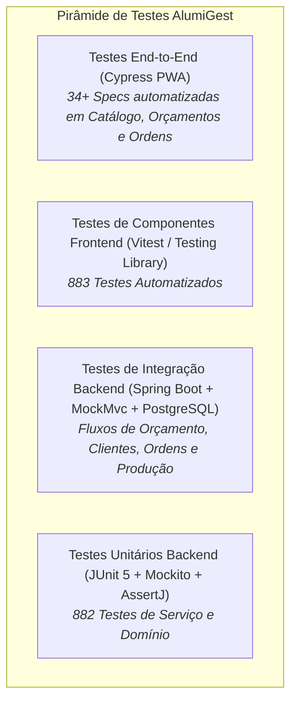

# 🧪 PLT — Plano Geral de Testes e Estratégia de Qualidade

| Campo | Valor |
|---|---|
| **Projeto** | AlumiGest — Sistema de Gestão para Vidraçaria e Esquadrias |
| **Sigla** | ALG |
| **Versão** | 2.3.0 (Tríade Documental de Testes: TEA, RTM e RET, Expansão E2E Cypress e Release 2) |
| **Data** | 28/10/2026 |
| **Responsável de QA** | Herbert Carvalho dos Santos / Jose Guylherme / Equipe de Engenharia e QA |
| **Governança** | Docs-as-Code — Oficial de Governança (`alumigest-doc-governor`) |

---

## 1. 🎯 Objetivos de Qualidade

Este documento define a estratégia, a pirâmide de testes, as ferramentas, os ambientes e os critérios de aceitação adotados pela equipe do **AlumiGest** para assegurar a corretude, robustez, sigilo e usabilidade do sistema em todas as sprints.

### 🌟 Pilares de Qualidade
1. **Precisão Matemática e Engenharia de Corte:** Garantir que o motor de cálculo de vidro ($m^2$ com faturamento mínimo de $0.2500\text{ m}^2$), perfis lineares ($m$ com fórmulas paramétricas $2W+nH$ e arredondamento `RoundingMode.CEILING`), kits de ferragens e películas execute cálculos determinísticos via `BigDecimal` sem desvios de ponto flutuante.
2. **Sigilo Comercial e Segregação de Vias (Risco R11):** Garantir que a suíte automatizada valide que a emissão da Ficha Técnica de Oficina (`TechnicalPdfPageEvent`) não contenha nenhuma menção a preços de custo, venda, margens ou cifras em R$.
3. **Validação de Limites Físicos (Risco R12):** Validar alertas de subdimensionamento físico para vãos menores que 400 mm e bloqueio para medidas que excedam a dimensão máxima das chapas de vidro.
4. **Integridade de Dados e Transações:** Validar integridade referencial, restrições de unicidade (SKU, CPF/CNPJ, E-mail) e migrações Flyway.
5. **Resiliência e Tratamento de Erros:** Garantir que exceções de negócio retornem códigos HTTP semânticos (400, 404, 409, 422) com respostas padronizadas em português.
6. **Regressão Zero e Clean as You Code:** Executar suítes automatizadas a cada Pull Request integrado na branch `develop` com Quality Gate do SonarQube aprovado (New Code $\ge 80\%$, zero bugs/vulnerabilidades).

---

## 2. 🏛️ Pirâmide de Testes e Ferramental

| Nível de Teste | Escopo | Ferramentas / Frameworks | Métricas / Volume | Execução |
|---|---|---|---|---|
| **Unitário (Backend)** | Serviços de Domínio, Motores de Cálculo (`MaterialQuantityCalculator`), Mappers e Entidades | JUnit 5, Mockito, AssertJ | **882 testes** (Unitários + Integração) | Local (`mvn test`) e CI/CD GitHub Actions |
| **Integração (Backend)** | Controllers REST, Validações JSR-380/Zod, Filtros de Paginação e Exceptions | SpringBootTest, MockMvc, H2 / PostgreSQL Testcontainers | Cobertura integrada de Catálogo, Clientes, Orçamentos e Ordens | Local e CI/CD |
| **Componentes Frontend** | Modais, Seletores, Formulários, Schemas Zod e Hooks React Query | Vitest, React Testing Library, happy-dom | **883 testes** automatizados | Local (`npm run test`) |
| **End-to-End (Frontend)** | Catálogo PWA, Orçamentos, Conversão em O.S., Etiquetas Térmicas e Kanban Fabril | Cypress 13, TypeScript | **34+ specs** automatizadas | Local (`npm run test:e2e`) |
| **Aceitação (BDD / TEA)** | Validação de Regras de Negócio e Homologação com PO | Gherkin / BDD (Tríade Documental por sprint) | Cenários BDD por História de Usuário | Homologação em `develop.italuhub.cloud` |

---

### 2.1 📈 Governança da Tríade Documental de Testes (Docs-as-Code)

Para garantir rastreabilidade rigorosa entre os requisitos, a especificação formal, a execução manual e as suítes automatizadas, o AlumiGest estabelece a **Tríade Documental de Testes**, mantida estritamente na pasta `docs/projeto-001/003-teste/sprint-XX/`:

1. **`TEA-Testes_de_Aceitacao_SprintXX.md` (Planejamento e Critérios de Aceitação):**
   - Especificação de todos os cenários da sprint em formato BDD/Gherkin estruturado.
   - Padrão canônico da tabela de cenários E2E:
     `[#] | [Cenário E2E] | [Arquivo .cy.ts] | [Estratégia & Massa] | [Dado] | [Quando] | [Então] | [Status]`
   - Discrimina a **Estratégia de Execução**:
     - *E2E Integrado Real (Full Stack):* Execução integrada contra a API REST real e banco PostgreSQL populado via seeds.
     - *E2E Mockado / Frontend-Isolated:* Execução com isolamento de rede via `cy.intercept` e fixtures JSON.

2. **`RTM-Roteiro_de_Testes_Manuais_SprintXX.md` (Guia de Reprodução Operacional na UI):**
   - Roteiro passo a passo permitindo que testadores, desenvolvedores e o Product Owner reproduzam visualmente e manualmente cada cenário E2E na interface gráfica web.
   - Inclui: Pré-requisitos de inicialização de ambiente, dados necessários, sequenciamento exato de cliques e digitações, comportamentos visuais esperados e validações de sucesso/erro.

3. **`RET-Relatorio_Execucao_Testes_SprintXX.md` (Evidências Formais de Execução e Homologação):**
   - Registro formal das evidências de execução da suíte automatizada (`it()`), taxas de aprovação, métricas do SonarQube, duração de execução e links para PRs/commits.
   - Rastreamento e catalogação de bugs e defeitos encontrados no ciclo in-sprint, vinculados ao catálogo oficial [`RBD-Registro_de_Bugs_e_Defeitos.md`](file:///c:/Users/italo/Desktop/Projects/alumigest/docs/projeto-001/003-teste/RBD-Registro_de_Bugs_e_Defeitos.md).

---

## 3. 🌐 Ambientes e Execução

| Ambiente | Propósito | URL / Endpoint | Banco de Dados | Pipeline / Monitoramento |
|---|---|---|---|---|
| **Local (DEV)** | Desenvolvimento ativo | `http://localhost:5173` (Front) / `8080` (Back) | PostgreSQL 16 (Docker Compose) | Execução local via terminal |
| **CI (GitHub Actions)** | Validação de PRs e SonarQube | Runner Ubuntu (GitHub Actions) | JaCoCo XML + SonarScanner | Pipeline `.github/workflows/ci.yml` |
| **Staging / Homologação** | Validação E2E integrada e testes de aceitação | `https://develop.italuhub.cloud` | PostgreSQL 16 em Nuvem (Coolify) | Deploy contínuo da branch `develop` |

---

## 4. 📊 Critérios de Aceitação e Definição de Pronto (DoD de QA)

Um item só é considerado pronto e elegível para merge quando:
1. **100% dos testes unitários e de integração passarem** sem falhas ou erros (`mvn clean verify`).
2. **Cobertura de linhas de código superior a 80%** nos serviços críticos de negócio (`BudgetService`, `BudgetQuantityService`, `ProductService`, `ClientService`, `OrderService`).
3. **Quality Gate do SonarQube Aprovado** no GitHub Actions (zero bugs, zero vulnerabilidades e cobertura em código novo $\ge 80\%$).
4. **Specs Cypress executando com 100% de sucesso** em modo headless (`npm run test:e2e`).
5. **Tríade Documental de Testes (`TEA`, `RTM`, `RET`) gerada e arquivada** na pasta da respectiva sprint em `docs/projeto-001/003-teste/sprint-XX/`.
6. **Defeitos e incidentes catalogados** no [`RBD-Registro_de_Bugs_e_Defeitos.md`](file:///c:/Users/italo/Desktop/Projects/alumigest/docs/projeto-001/003-teste/RBD-Registro_de_Bugs_e_Defeitos.md) e reportados via template interativo YAML (`.github/ISSUE_TEMPLATE/bug_report.yml`).

---

*Plano homologado pela Equipe de QA AlumiGest — Atualizado em 28/10/2026*
