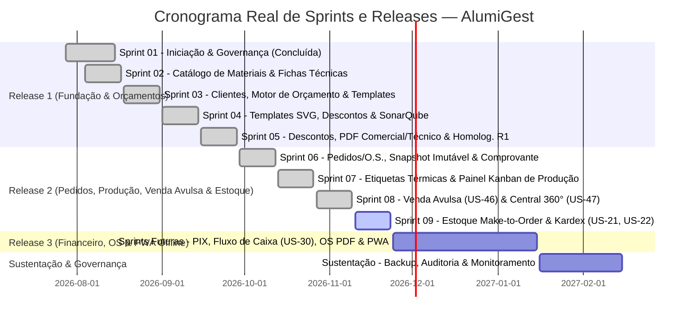

# 📋 PBL — Product Backlog (AlumiGest)

**Projeto:** AlumiGest — Sistema de Gestão para Vidraçaria e Esquadrias  
**Cliente:** Alumiportas | **PO:** José Guylherme dos Santos Melo | **Tech Lead:** Italo Jefferson Lima dos Santos  
**Versão:** 4.0 (Alinhado com Entregas Reais até Sprint 08 — `v0.8.0` — e Sprint 09 Ativa)  
**Data:** 18 de Novembro de 2026  

---

## 1. 🎯 Visão Geral das Releases e Sprints

O backlog do AlumiGest é executado em **Sprints quinzenais**, priorizado dinamicamente junto ao Product Owner:

> 💡 **Referência de Sincronização**: Consulte a [Tabela De-Para Oficial](../../planejamento/de-para-user-stories.md) e o [Backlog Centralizado](../../planejamento/backlog/README.md).

---

## 2. 📦 Estrutura de Épicos e User Stories (`US-01` a `US-47`)

### 🟢 Release 1 (`v0.1.0` a `v0.5.0`) — Fundação, Catálogo & Orçamentos Comerciais *(Concluída)*

* **EP-01: Governança & Infraestrutura Base (Sprint 01)**
  * `US-01`: Configurar Infraestrutura Monorepo, Docker e Governança *(Concluída)*
* **EP-02: Catálogo de Materiais & Fichas Técnicas (Sprint 02)**
  * `US-02`: Gerenciar Catálogo de Materiais Genérico (Vidros, Perfis, Ferragens, Películas) *(Concluída)*
  * `US-03`: Gerenciar Produtos e Fichas Técnicas de Esquadrias *(Concluída)*
* **EP-03: Clientes, Motor de Precificação & Templates Paramétricos (Sprint 03)**
  * `US-04`: Gerenciar Clientes PF e PJ *(Concluída)*
  * `US-05`: Refatorar Produtos com Templates Paramétricos de Esquadrias *(Concluída)*
  * `US-06`: Criar e Gerenciar Orçamentos de Venda *(Concluída)*
  * `US-07`: Motor de Cálculo Físico e Precificação de Orçamentos *(Concluída)*
  * `US-08`: Pipeline CI/CD com SonarQube e Testes E2E Cypress *(Concluída)*
* **EP-04: Condições Comerciais, Propostas em PDF & Homologação R1 (Sprint 04/05)**
  * `US-09`: Aplicar Descontos e Condições Comerciais no Orçamento *(Concluída)*
  * `US-10`: Emitir e Exportar Orçamento em PDF - Via Comercial e WhatsApp *(Concluída)*
  * `US-11`: Emitir Orçamento em PDF - Via Técnica de Oficina *(Concluída)*
  * `US-12`: Homologação Integrada e Validação da Release 1 *(Concluída)*

---

### 🟡 Release 2 (`v0.6.0` a `v0.8.0+`) — Pedidos/O.S., Produção, Expansão Comercial & Estoque

* **EP-05: Pedidos de Venda / O.S. & Lock de Preços (Sprint 06 — `v0.6.0`)**
  * `US-13`: Aprovar Orçamento e Converter em Pedido de Venda / O.S. *(Concluída)*
  * `US-14`: Snapshot Imutável e Lock de Preços do Pedido *(Concluída)*
  * `US-15`: Gestão de Status, Prazos e Cancelamento de Pedidos *(Concluída)*
  * `US-16`: Emissão do Comprovante do Pedido de Venda *(Concluída)*
* **EP-06: Identificação no Chão de Fábrica & Kanban Operacional (Sprint 07 — `v0.7.0`)**
  * `US-17`: Emitir Etiquetas de Identificação de Peças por Item do Pedido (100×60mm PDF & BPLB) *(Concluída)*
  * `US-18`: Acompanhar Produção via Painel Kanban de Pedidos de Venda *(Concluída)*
* **EP-07: Expansão Comercial, Atendimento 360° & Ficha Técnica (Sprint 08 — `v0.8.0`)**
  * `US-46`: Módulo de Venda Avulsa de Partes (Vidro m², Alumínio Metro Linear, Ferragens e Películas) *(Concluída)*
  * `US-47`: Central 360° do Cliente com Gestão Unificada de Orçamentos, O.S., Ficha Técnica A4 e Etiquetas *(Concluída)*
* **EP-08: Engenharia de Corte & Gestão de Estoque Make-to-Order (Sprint 09 Ativa / Backlog)**
  * `US-19`: Consolidar Lista Linear e Plana de Corte do Pedido *(Backlog)*
  * `US-20`: Gerar Ficha Técnica de Montagem por Item do Pedido *(Parcialmente atendida via `ProductionSheetService` na US-47.3; refinamentos no Backlog)*
  * `US-21`: Reservar e Baixar Matéria-Prima no Estoque Automaticamente (Make-to-Order) *(🔄 Em Andamento — Sprint 09)*
  * `US-22`: Consultar Posição de Estoque e Kardex de Movimentações *(🔄 Em Andamento — Sprint 09)*
  * `US-23`: Homologação Integrada e Validação da Release 2 *(Backlog)*

---

### 🔵 Release 3 — Financeiro, PIX, O.S. em Campo & PWA Offline

* **EP-09: Pagamentos Instantâneos via PIX**
  * `US-24`: Gerar Cobrança PIX com QR Code Dinâmico e Copia e Cola *(Backlog)*
  * `US-25`: Confirmar Pagamento PIX via Webhook com Liberação Automática *(Backlog)*
  * `US-26`: Modal PIX Interativo no Frontend e Histórico de Transações *(Backlog)*
* **EP-10: Gestão Financeira & Fluxo de Caixa Enxuto**
  * `US-30`: Acompanhar Fluxo de Caixa Mensal e Despesas Operacionais *(Backlog — substitui `US-27`, `US-28`, `US-29`, `US-34`, `US-35` e `US-36`, oficialmente descartadas)*
* **EP-11: Ordem de Serviço & PWA Offline para Orçamentos**
  * `US-33`: Emitir Ordem de Serviço (OS) em PDF Padronizado *(Backlog)*
  * `US-37`: Instalar PWA Desktop/Mobile e Elaborar Rascunhos de Orçamentos Offline via IndexedDB *(Backlog)*
  * `US-40`: Executar Carga Inicial de Dados e Importador de Clientes via CSV *(Backlog)*
  * `US-41`: Homologação Integrada Ponta a Ponta da Release 3 *(Backlog)*
  * *Histórias oficialmente descartadas em refinamento (ver `docs/planejamento/backlog/descartadas/`):* `US-27`, `US-28`, `US-29`, `US-31`, `US-32`, `US-34`, `US-35`, `US-36`, `US-38`, `US-39`, `US-42`.

---

### 🟣 Sustentação & Governança Corporativa

* **EP-12: Estabilização, Recuperação de Desastres & Auditoria**
  * `US-43`: Executar Rotinas de Backup Automático e Disaster Recovery *(Backlog)*
  * `US-44`: Registrar Trilha de Auditoria Imutável para Ações Críticas *(Backlog)*
  * `US-45`: Monitorar Saúde do Sistema com Actuator e Publicar Documentação *(Backlog)*
