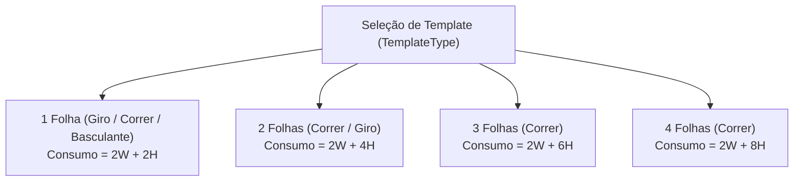
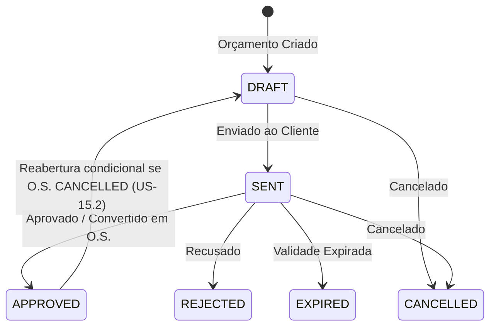

# 📐 RN — Regras de Cálculo e Negócio (AlumiGest)
**Projeto:** AlumiGest — Sistema de Gestão para Vidraçaria e Esquadrias  
**Cliente / Parceiro Social:** Alumiportas  
**Versão:** 5.0 (Consolidado com Venda Avulsa `partsale`, Plano de Corte `production` e Modelo Make-to-Order de Estoque)  
**Data:** 18 de Novembro de 2026  
**Governança:** Docs-as-Code — Oficial de Governança (`alumigest-doc-governor`)  

---

## 1. 🎯 Introdução e Desacoplamento Arquitetural

Este documento consolida as **regras de negócio operacionais, restrições físicas de engenharia e fórmulas matemáticas exatas** implementadas nos motores de cálculo do AlumiGest:
* **Orçamentos de Esquadrias:** `br.edu.ifpb.alumigest.budgets`
* **Venda Avulsa de Partes (US-46):** `br.edu.ifpb.alumigest.partsale.calculator`
* **Ficha Técnica de Corte e Produção (US-47.3):** `br.edu.ifpb.alumigest.orders.service.production`
* **Estoque e Reservas Make-to-Order (Sprint 09):** `br.edu.ifpb.alumigest.stock`

### 🌟 Conceito Fundamental: Insumos Básicos vs. Templates de Esquadrias
1. **Insumos Atômicos do Catálogo (`catalog`):**
   * **Vidros:** Medidos por área ($m^2$) com suporte a espessuras de **2.00mm a 10.00mm** e regra de faturamento mínimo.
   * **Perfis de Alumínio:** Medidos por metro linear ($m$), fornecidos em barras comerciais de **3.00m** ou **6.00m** (até `6000 mm`), abrangendo linhas como **Rometal**, **Alternativa**, **Suprema** e puxadores lineares.
   * **Películas:** Medidas por área de aplicação ($m^2$) sobre o vidro (Fumê G5/G20, Jateada, Leitosa, Espelhada).
   * **Ferragens e Componentes:** Medidos por **Unidade (`UN`)**, **Par (`PAR`)** ou **Metro Linear (`METRO`)**.
2. **Templates de Esquadrias (Modelos Paramétricos):**
   * Produtos finais representam receitas de corte e montagem (`TemplateType` / `DoorTemplateType`).
   * As medidas nominais de entrada no orçamento e na O.S. são fornecidas estritamente em **milímetros ($mm$)**.
   * A mão de obra (`laborCost`) é desacoplada do catálogo mestre (`V10`) e congelada no pedido (`valor_mao_de_obra`, `V22`).

---

## 2. 🪟 Cálculo de Vidros em Orçamentos (Área em $m^2$)

### 2.1 Fórmulas Matemáticas Base

$$\text{Largura (m)} = \frac{\text{Largura (mm)}}{1000}, \quad \text{Altura (m)} = \frac{\text{Altura (mm)}}{1000}$$

$$\text{Área Nominal Unitária } (m^2) = \text{Largura (m)} \times \text{Altura (m)}$$

$$\text{Área Faturada Unitária } (m^2) = \max(\text{Área Nominal Unitária}, 0.25)$$

$$\text{Área Total Faturada } (m^2) = \lceil \text{Área Faturada Unitária} \times \text{Quantidade} \rceil_{2\text{ decimais, CEILING}}$$

$$\text{Preço Base Vidro (R\$)} = \text{Área Total Faturada } (m^2) \times \text{Preço Unitário do } m^2$$

### 2.2 Regras Operacionais de Vidraçaria
| ID | Regra | Descrição e Comportamento no Sistema | Classe de Implementação |
| :--- | :--- | :--- | :--- |
| **RN-V01** | **Espessuras Homologadas** | O sistema suporta nativamente vidros finos (**2.00mm e 4.00mm**) e vidros temperados estruturais (**6.00mm, 8.00mm e 10.00mm**). | `GlassService` |
| **RN-V02** | **Cálculo da Massa do Vidro** | $\text{Peso (kg)} = \text{Área } (m^2) \times \text{Espessura (mm)} \times 2,5 \text{ kg/m²}$. | `GlassQuantityCalculator` |
| **RN-V03** | **Área Mínima de Faturamento** | Se a área calculada de uma peça for inferior a **$0,25\text{ m}^2$**, adota-se o piso fixo de **$0,25\text{ m}^2$** para absorver corte e retalho de chapa. | `GlassQuantityCalculator` |
| **RN-V04** | **Precedência de Metragem Manual** | Caso o operador informe metragem manual válida ($> 0$), o sistema prioriza o valor manual, emitindo aviso caso seja inferior ao vão físico. | `BudgetQuantityService` |

---

## 3. 🔩 Cálculo de Perfis de Alumínio em Orçamentos (Metro Linear)

### 3.1 Fórmulas Paramétricas por Modelo de Template (`ProfileQuantityCalculator`)

Sendo $W = \frac{\text{Largura (mm)}}{1000}$ e $H = \frac{\text{Altura (mm)}}{1000}$:

1. **1 Folha (`SWING_1_LEAF`, `SLIDING_1_LEAF`, `MAX_AR_WINDOW_1_LEAF`):** $\text{Metros/Un} = 2W + 2H$
2. **2 Folhas (`SLIDING_2_LEAF`, `SWING_2_LEAF`):** $\text{Metros/Un} = 2W + 4H$
3. **3 Folhas (`SLIDING_3_LEAF`):** $\text{Metros/Un} = 2W + 6H$
4. **4 Folhas (`SLIDING_4_LEAF`):** $\text{Metros/Un} = 2W + 8H$
5. **Consumo Total com Arredondamento:**
   $$\text{Total Perfis (m)} = \lceil \text{Metros por Unidade} \times \text{Quantidade} \rceil_{2\text{ decimais, CEILING}}$$

### 3.2 Regras Operacionais de Perfis
| ID | Regra | Descrição | Classe de Implementação |
| :--- | :--- | :--- | :--- |
| **RN-AL01** | **Linhas Homologadas** | Suporte às linhas **Rometal**, **Alternativa** e **Suprema**. | `AluminumProfileService` |
| **RN-AL02** | **Comprimento de Barra Comercial** | Barras padrão cadastradas com **3.00m** ou **6.00m**. | `AluminumProfileService` |
| **RN-AL03** | **Classificação de Catálogo** | Referência do fornecedor, NCM opcional, `family_code` (`V16`) e `is_handle` (`V17`). | `AluminumProfileMapper` |
| **RN-AL04** | **Puxadores Integrados** | Puxadores lineares calculados conforme altura da folha ou comprimento nominal informado. | `ProfileQuantityCalculator` |
| **RN-AL05** | **Alerta de Subdimensionamento** | Metragem manual inferior ao consumo físico necessário dispara aviso. | `BudgetQuantityService` |

---

## 4. 🎨 Cálculo de Películas e Ferragens em Orçamentos

### 4.1 Películas (`FilmQuantityCalculator`)
$$\text{Área Película (m²)} = \lceil \max(\text{Largura (m)} \times \text{Altura (m)}, 0.25) \times \text{Quantidade} \rceil_{2\text{ decimais, CEILING}}$$
$$\text{Preço Película (R\$)} = \text{Área Película (m²)} \times \text{Preço Unitário de Aplicação por } m^2$$

### 4.2 Ferragens e Componentes (`HardwareQuantityCalculator`)
1. **Unidade Fixa (`UN`):** $\text{Qtd Total} = \text{Qtd Declarada} \times \text{Qtd de Esquadrias}$
2. **Par (`PAR`):** $\text{Qtd Total (Pares)} = \text{Qtd Declarada (Pares)} \times \text{Qtd de Esquadrias}$
3. **Metro Linear (`METRO`):** $\text{Qtd Total (m)} = \text{Metragem Declarada} \times \text{Qtd de Esquadrias}$

---

## 5. 🛒 Motor de Cálculo da Venda Avulsa de Partes (`partsale.calculator` — US-46)

O módulo `partsale` implementa o padrão **Strategy + Factory** (`PartCalculatorFactory` injetando `List<PartItemCalculator>` por `MaterialCategoryType`), com precisão estrita via `BigDecimal`:

### 5.1 Vidro Avulso (`GlassPartCalculator` — `GLASS`)
* **Área bruta unitária (4 casas, `HALF_EVEN`):**
  $$\text{Área Bruta} = \left[\frac{\text{widthMm} \times \text{heightMm}}{1.000.000}\right]_{4\text{ decimais, HALF\_EVEN}}$$
* **Piso Mínimo Obrigatório (`MIN_BILLABLE_AREA = 0.2500`):**
  $$\text{Área Faturável Unitária} = \max(\text{Área Bruta}, 0.2500)$$
  * Sinaliza `minimumAreaApplied = true` quando $\text{Área Bruta} < 0.2500$.
* **Totalizações:**
  $$\text{calculatedUnitMeasure} = [\text{Área Faturável Unitária} \times \text{quantity}]_{4\text{ decimais, HALF\_EVEN}}$$
  $$\text{totalPrice} = [\text{calculatedUnitMeasure} \times \text{unitPrice}]_{2\text{ decimais, HALF\_EVEN}}$$

### 5.2 Perfil de Alumínio Avulso (`AluminumProfilePartCalculator` — `PROFILE`)
* **Limite de Barra (`MAX_STANDARD_BAR_LENGTH_MM = 6000`):** rejeita `heightMm <= 0` ou `heightMm > 6000`.
* **Conversão e Perda (`HALF_UP`, escala 4):**
  $$\text{Comprimento (m)} = \left[\frac{\text{heightMm}}{1000}\right]_{4\text{ decimais, HALF\_UP}}$$
  $$\text{Metragem Líquida} = \text{Comprimento (m)} \times \text{quantity}$$
  $$\text{calculatedUnitMeasure} = [\text{Metragem Líquida} \times (1 + \text{lossFactor})]_{4\text{ decimais, HALF\_UP}}$$
  *(Adota $\text{lossFactor} = 0$ caso seja nulo ou negativo).*
* **Preço Total:** $[\text{calculatedUnitMeasure} \times \text{unitPrice}]_{2\text{ decimais, HALF\_EVEN}}$.

### 5.3 Película Avulsa (`FilmPartCalculator` — `FILM`)
* **Área líquida e perda de bobina (`HALF_EVEN`, escala 4):**
  $$\text{Área Líquida} = \left[\frac{\text{widthMm} \times \text{heightMm}}{1.000.000}\right]_{4\text{ decimais, HALF\_EVEN}} \times \text{quantity}$$
  $$\text{calculatedUnitMeasure} = [\text{Área Líquida} \times (1 + \text{lossFactor})]_{4\text{ decimais, HALF\_EVEN}}$$
* **Preço Total:** $[\text{calculatedUnitMeasure} \times \text{unitPrice}]_{2\text{ decimais, HALF\_EVEN}}$ (`minimumAreaApplied = false`).

### 5.4 Ferragem Avulsa (`HardwarePartCalculator` — `HARDWARE`)
* **Cobrança unitária sem dimensões físicas:**
  $$\text{calculatedUnitMeasure} = [\text{quantity}]_{4\text{ decimais, HALF\_UP}}, \quad \text{totalPrice} = [\text{unitPrice}_{2, \text{HALF\_EVEN}} \times \text{quantity}]_{2\text{ decimais, HALF\_EVEN}}$$

### 5.5 Validação Física e Ciclo de Vida (`PartSaleValidationService`, `PartSaleStatus`)
* **Limites Físicos de Chapa/Bobina (`PartSaleValidationService.validatePhysicalLimits`):** se `widthMm > material.maxWidthMm` ou `heightMm > material.maxHeightMm`, lança `BusinessException` (HTTP `422 Unprocessable Entity`).
* **Máquina de Estados `PartSaleStatus`:** `DRAFT` ➔ `APPROVED` ou `CANCELLED`; `APPROVED` ➔ `CANCELLED`; `CANCELLED` é estado terminal.

---

## 6. 🛠️ Engenharia de Corte da Ficha Técnica de Produção (`orders.service.production` — US-47.3)

A Ficha Técnica A4 (`ProductionSheetService` + `ProductionSheetPdfService`) apura o plano de corte de cada item congelado da O.S. utilizando estratégias `FrameCalculatorStrategy`:

### 6.1 Janela de Correr Linha Suprema (`SupremaSlidingWindowCalculator`)
Aplicada quando o nome do produto/item contém `JANELA`, `CORRER` e `SUPREMA` (com largura nominal $L$, altura nominal $A$ e quantidade $Q$):
* **Constantes de Engenharia:** `FOLGA_ALTURA_FOLHAS_MM = 42`, `FOLGA_LARGURA_BORRACHA_VIDRO = 12`, transpasse $= +15\text{ mm}$.
* **Marco:** `SU-001` (Marco Lateral: $A\text{ mm}$, `90°`, $2Q$ peças) e `SU-002` (Marco Superior/Inferior: $L\text{ mm}$, `90°`, $2Q$ peças).
* **Folhas Móveis:**
  $$\text{alturaFolha} = \max(0, A - 42), \quad \text{larguraFolha} = \max\left(0, \lfloor L / 2 \rfloor + 15\right)$$
  * `SU-039` (Perfil Montante: $\text{alturaFolha}$, `90°`, $4Q$ peças) e `SU-040` (Perfil Travessa: $\text{larguraFolha}$, `45°`, $4Q$ peças).
* **Vidros:** $\text{larguraVidro} = \max(0, \text{larguraFolha} - 12)$, $\text{alturaVidro} = \max(0, \text{alturaFolha} - 12)$ ($2Q$ peças).
* **Acessórios:** `ROL-112` (Roldana Dupla Suprema: $4Q$ `UN`) e `GUA-080` (Borracha de Cunha: $\max(1, \lfloor ((L + A) \times 2 \times Q) / 1000 \rfloor)$ `MT`).

### 6.2 Estratégia Universal de Fallback (`DefaultFrameCalculator`)
Classifica itens não cobertos por estratégia específica em `MIRROR` (`ESPELHO`), `BOX` (`BOX`), `SWING` (`GIRO`/`PIVOT`), `AWNING` (`MAXIM`/`BASCUL`) ou `GENERIC`:
* **Vidros:**
  * `BOX`: 2 folhas (`Folha Fixa` e `Folha Móvel`) com largura $\max(0, \lfloor L/2 \rfloor + 25)$ e altura $A$.
  * `SWING`: largura $\max(0, L - 80)$, altura $\max(0, A - 80)$.
  * `AWNING`: largura $\max(0, L - 50)$, altura $\max(0, A - 50)$.
  * `MIRROR` / `GENERIC`: dimensões nominais $L \times A$.
* **Alumínio e Acessórios:** gera cortes a `45°`/`90°` (`MOLD-*`, `BX-*`, `BAT-*`/`FOL-*` com deduções `-60 mm` largura e `-40 mm` altura na folha, `MX-*` com `-30 mm` no quadro móvel, `EST-*`) e ferragens/vedações proporcionais.

---

## 7. 💰 Precificação Consolidada, Descontos e Máquinas de Estado

### 7.1 Composição Financeira em Cascata (`BudgetPricingService`)
$$\text{Subtotal do Item} = \left[ \sum_{\text{opções}} (\text{Preço Unitário do Insumo} \times \text{Quantidade Calculada}) \times \text{Qtd Esquadrias} \right] + \text{Mão de Obra do Item (R\$)}$$
$$\text{Subtotal do Orçamento} = \sum_{i=1}^{n} \text{Subtotal do Item}_i$$
1. **Desconto Percentual (`PERCENTUAL`):** $0\% \le P \le 100\%$, $\text{Desconto} = [\text{Subtotal} \times P / 100]_{2, \text{HALF\_EVEN}}$.
2. **Desconto por Valor Fixo (`VALOR_FIXO`):** $0 \le V \le \text{Subtotal}$, $P_{\text{eq}} = [V \times 100 / \text{Subtotal}]_{2, \text{HALF\_EVEN}}$.
3. **Total Final:** $\text{Subtotal} - \text{Valor do Desconto}$.

### 7.2 Ciclo de Vida do Orçamento (`BudgetStatus`) e da O.S. (`OrderStatus`)

* **Máquina de Estados Fabril (`OrderStatus`):** `CREATED` (default `V25`) ➔ `WAITING_PRODUCTION` ➔ `IN_PRODUCTION` ➔ `COMPLETED` (grava `data_conclusao` em `America/Sao_Paulo`). Cancelamento (`CANCELLED`) é permitido apenas em `CREATED` ou `WAITING_PRODUCTION` (`OrderStatus.canCancel()`).

---

## 8. 📦 Regras de Estoque Make-to-Order (Sprint 09 — US-21 / US-22)

1. **Invariante Fundamental de Saldos:** $\text{available\_quantity} = \text{physical\_quantity} - \text{reserved\_quantity}$.
2. **Reserva Não Bloqueante (Make-to-Order):** A aprovação de O.S. ou criação de Venda Avulsa nunca é bloqueada por falta de saldo; reservas em déficit geram $\text{available\_quantity} < 0$ para sinalizar **Necessidade de Compra**.
3. **Bloqueio de Saldo Físico Negativo:** Saídas manuais (`SCRAP_LOSS` / `MANUAL_ADJUSTMENT`) que resultariam em $\text{physical\_quantity} < 0$ são rejeitadas com HTTP `422 Unprocessable Entity`.
4. **Imutabilidade Kardex:** Todos os lançamentos em `tb_stock_movements` são estritamente *append-only*.

---

## 9. 📋 Matriz de Rastreabilidade Docs-as-Code

| Regra Documentada | Código Backend Correspondente | Teste Automatizado |
|---|---|---|
| Perfis/Vidros/Películas/Ferragens em Orçamentos | `budgets.calculator.*QuantityCalculator` | `*QuantityCalculatorTest` |
| Cálculo de Subtotal e Desconto Comercial | `budgets.service.BudgetPricingService` | `BudgetPricingServiceTest` |
| Segregação de Vias (Comercial / Ficha Técnica) | `budgets.service.BudgetPdfService` | `BudgetPdfServiceTest` |
| Vidro avulso (`0.2500 m²`, `HALF_EVEN`) | `partsale.calculator.GlassPartCalculator` | `GlassPartCalculatorTest` |
| Perfil avulso (até `6000 mm`, perda, `HALF_UP`) | `partsale.calculator.AluminumProfilePartCalculator` | `AluminumProfilePartCalculatorTest` |
| Película e Ferragem avulsa | `partsale.calculator.FilmPartCalculator`, `HardwarePartCalculator` | `FilmPartCalculatorTest`, `HardwarePartCalculatorTest` |
| Limites de chapa/bobina na Venda Avulsa | `partsale.service.PartSaleValidationService` | `PartSaleValidationServiceTest` |
| Ficha Técnica de Corte (Suprema & Fallback) | `orders.service.production.strategies.*` | `SupremaSlidingWindowCalculatorTest`, `DefaultFrameCalculatorTest` |
| Invariante e concorrência Make-to-Order (S09) | `stock.service.StockService` | `StockServiceTest`, `StockLifecycleIntegrationTest` |

---
*Documento homologado pelo Oficial de Governança Técnica (`alumigest-doc-governor`) em 18/11/2026.*
