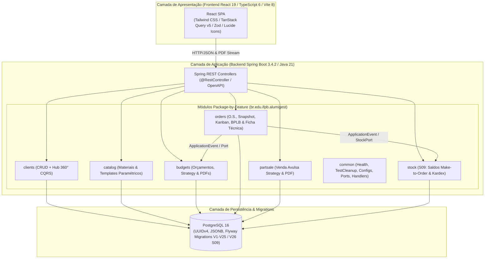
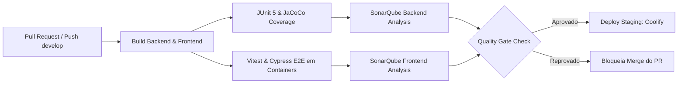

# 🏛️ ARQ — Documento de Arquitetura de Software (AlumiGest)

| Metadado | Descrição |
|---|---|
| **Projeto** | AlumiGest — Sistema de Gestão para Vidraçaria e Esquadrias |
| **Sigla** | ALG |
| **Versão** | 4.0 (Consolidado com Release v0.8.0 — Ordens, Produção, Venda Avulsa, Hub 360° e Prévia Estoque S09) |
| **Data** | 18/11/2026 |
| **Governança** | Docs-as-Code — Oficial de Governança (`alumigest-doc-governor`) |

---

## Histórico de Revisões

| Data | Versão | Descrição | Autor |
|---|---|---|---|
| 05/08/2026 | 1.0 | Versão inicial do Documento de Arquitetura | Ítalo Jefferson / Equipe AlumiGest |
| 31/08/2026 | 2.0 | Atualização para padrão `br.edu.ifpb.alumigest`, UUIDs nativos, Factory Strategy, React + Vite e Flyway V10 | Equipe AlumiGest (Scrum Master: Italo Santos) |
| 24/09/2026 | 3.0 | Motor de emissão PDF (OpenPDF), segregação de vias, TanStack Query v5 + Zod e Quality Gate SonarQube | Equipe AlumiGest (Tech Lead: Ítalo Jefferson) |
| 18/11/2026 | 4.0 | Inclusão dos módulos `orders` (O.S., etiquetas BPLB/PDF, Kanban e Ficha Técnica), `partsale` (Venda Avulsa), Hub 360° (`ClientHubController`), prévia do módulo `stock` (Sprint 09), stack React 19 / TypeScript 6 / Vite 8 e histórico Flyway V1–V25 | Equipe AlumiGest (Tech Lead: Ítalo Jefferson) |

---

## 1. Visão Geral da Arquitetura

O AlumiGest adota o estilo arquitetural **Monolítico Modular Desacoplado**, separando claramente a camada de serviços e regras de negócio no Backend (Java 21 / Spring Boot 3.4.2 REST API) da camada de apresentação no Frontend (React 19.2 / TypeScript 6.0 / Vite 8.2 SPA/PWA), unificados em um monorepo para rastreabilidade **Docs-as-Code**.

### 1.1 Diagrama de Alto Nível (Mermaid)



---

## 1.2 Decisões Arquiteturais Registradas (ADRs)

| # | Decisão | Justificativa |
|---|---|---|
| **ADR-01** | **Monolítico Modular** | Elimina complexidade operacional e latência de rede entre módulos fortemente relacionados (orçamento, O.S., produção e estoque). |
| **ADR-02** | **Package-by-Feature com Portas e Eventos** | Alta coesão e desacoplamento entre `budgets`, `catalog`, `clients`, `orders`, `partsale`, `stock` e `common` (uso de `OrderQueryPort`, `StockPort` e `ApplicationEventPublisher`). |
| **ADR-03** | **Identificadores UUIDv4 Nativos** | Previne enumeração sequencial (IDOR) e suporta geração concorrente de registros. |
| **ADR-04** | **Padrão Strategy + Factory em Múltiplos Motores** | Aplicado em `MaterialCalculatorFactory` (`budgets`), `PartCalculatorFactory` (`partsale`) e `FrameCalculatorStrategy` (`orders.service.production`). |
| **ADR-05** | **Frontend React 19, Vite 8 e TanStack Query v5** | Cache declarativo de servidor, atualizações otimistas no Kanban e formulários validados com Zod. |
| **ADR-06** | **Flyway Database Migrations** | Evolução versionada e auditável do PostgreSQL 16 (`V1` a `V25` na `release/v0.8.0`). |
| **ADR-07** | **Segregação e Especialização Documental (OpenPDF & BPLB)** | Emissão dedicada de Proposta Comercial, Via Técnica com sigilo comercial, Comprovante de O.S., Ficha Técnica de Corte, Orçamento de Partes e Etiquetas Térmicas 100×60mm (PDF + script BPLB). |
| **ADR-08** | **Snapshot Imutável na Conversão de O.S.** | Deep copy de itens, opções e mão de obra em `tb_orders`/`tb_order_items`/`tb_order_item_options`, blindando pedidos contra reajustes de catálogo. |
| **ADR-09** | **Modelo Make-to-Order no Estoque (Sprint 09)** | Reservas automáticas sem bloqueio comercial por falta de estoque, protegidas por `@Lock(LockModeType.PESSIMISTIC_WRITE)` e trilha Kardex append-only. |

---

## 2. Arquitetura do Backend (Java 21 + Spring Boot 3.4.2)

### 2.1 Estrutura de Pacotes (`br.edu.ifpb.alumigest`)

```
backend/src/main/java/br/edu/ifpb/alumigest/
├── AlumiGestApplication.java
├── auth/                             # Reservado para evolução de autenticação (package-info)
├── budgets/                          # Orçamentos, Motor de Cálculo e PDFs
│   ├── calculator/                   # MaterialCalculatorFactory, Glass/Profile/Hardware/FilmQuantityCalculator, TemplateType
│   ├── config/                       # CompanyProperties
│   ├── controller/                   # BudgetController
│   ├── domain/                       # Budget, BudgetItem, BudgetItemOption, BudgetStatus, DiscountType, PaymentCondition
│   ├── dto/                          # BudgetCreateRequest, BudgetResponseDTO, DiscountRequest, etc.
│   ├── mapper/                       # BudgetMapper (MapStruct)
│   ├── repository/                   # BudgetRepository, BudgetItemRepository, BudgetItemOptionRepository
│   └── service/                      # BudgetService, BudgetPricingService, BudgetQuantityService, BudgetPdfService,
│                                     # BudgetOrderEventListener, pdf/* (BudgetPdfPageEvent, TechnicalPdfPageEvent, technical/*)
├── catalog/                          # Catálogo de Materiais e Templates Paramétricos
│   ├── controller/                   # AluminumProfileController, FilmController, GlassController, HardwareController,
│   │                                 # MaterialController (/api/v1/materials), ProductController (/api/v1/catalog/products)
│   ├── domain/                       # Material, MaterialGroup, Product, DoorTemplateType, MaterialCategoryType, TemplateConfig
│   ├── dto/, mapper/, repository/, service/
├── clients/                          # Cadastro de Clientes e Hub 360°
│   ├── controller/                   # ClientController, ClientHubController
│   ├── domain/                       # Client, PersonType
│   ├── dto/                          # ClientDashboardDto, ClientBudgetSummaryDto, ClientOrderSummaryDto, ClientOrderItemDto, etc.
│   ├── mapper/, repository/, service/ # ClientService, ClientHubService
├── orders/                           # Ordens de Serviço, Etiquetas, Kanban e Ficha Técnica
│   ├── controller/                   # OrderController (/api/v1/orders), OrderLegacyController
│   ├── domain/                       # Order, OrderItem, OrderItemOption, OrderStatus, ApprovalChannel, OrderCancelledEvent
│   ├── dto/                          # OrderResponse, OrderSummaryResponse, OrderConvertRequest, OrderCancelRequest, production/*
│   ├── mapper/, repository/          # OrderMapper, OrderRepository, OrderItemRepository
│   └── service/                      # OrderServiceImpl, OrderCodeGenerator, OrderItemSnapshotResolver, OrderLabelService,
│                                     # LabelPdfService, OrderPdfService, OrderQueryAdapter,
│                                     # pdf/ (ThermalLabelDataResolver, ThermalLabelPdfRenderer),
│                                     # thermal/ (ThermalLabelBplbRenderer),
│                                     # production/ (ProductionSheetService, ProductionSheetPdfService, strategies/*)
├── partsale/                         # Venda Avulsa de Partes (US-46)
│   ├── calculator/                   # PartCalculatorFactory, PartItemCalculator, Glass/AluminumProfile/Film/HardwarePartCalculator
│   ├── controller/                   # PartSaleController (/api/v1/part-sales)
│   ├── domain/                       # PartSale, PartSaleItem, PartSaleStatus
│   ├── dto/, repository/, service/   # PartSaleServiceImpl, PartSaleCodeGenerator, PartSalePdfService, PartSaleValidationService
├── stock/                            # [Sprint 09 - em branch] Estoque Make-to-Order & Kardex (US-21 / US-22)
│   ├── controller/                   # StockController (/api/v1/stock)
│   ├── domain/                       # StockItem, StockMovement, StockMovementType, StockAlertStatus, StockSortField
│   ├── dto/, mapper/, repository/, service/ # StockService, StockPort, StockOrderEventListener
└── common/                           # Infraestrutura Compartilhada
    ├── config/                       # CorsConfig, OpenApiConfig
    ├── controller/                   # HealthController, TestCleanupController
    ├── dto/                          # ApiResponse, PageResponse, ErrorResponse
    ├── exception/                    # GlobalExceptionHandler, BusinessException, ResourceNotFoundException, etc.
    └── port/                         # OrderQueryPort
```

---

## 3. Arquitetura do Frontend (React 19.2 + TypeScript 6.0 + Vite 8.2)

### 3.1 Estrutura de Diretórios (`frontend/src`)

```
frontend/src/
├── components/
│   ├── icons/
│   ├── layout/                       # Sidebar, Topbar, DashboardLayout
│   └── ui/                           # Button, Input, Modal, Table, Tabs, Badge, Card, Toast
├── features/
│   ├── auth/
│   ├── budgets/                      # Wizard de orçamentos, Builder CAD SVG, Descontos, Resumo WhatsApp
│   ├── catalog/                      # Abas de Vidros, Perfis, Ferragens e Películas + Modais
│   ├── customers/                    # Hub 360° (CustomerHubPage, MasterSidebar, HeroCard, BudgetsTab, OrdersTab, EditModal)
│   ├── orders/                       # Listagem/Detalhe de O.S., ThermalLabelModal, CancelOrderModal
│   ├── part-sales/                   # Venda Avulsa (Form, Grid, ItemFields especializados, Autocomplete, Summary)
│   ├── production/                   # Painel Kanban (Board, Cards com SLA, Filters, Metrics)
│   ├── products/                     # Gestão de Templates Paramétricos
│   └── stock/                        # [Sprint 09 - em branch] StockAlertBadge, KardexDrawer, ScrapLossModal
├── pages/                            # CatalogPage, BudgetsPage, BudgetNewPage, BudgetDetailPage,
│                                     # CustomerHubPage, OrderListPage, OrderDetailPage, PartSaleListPage,
│                                     # PartSaleFormPage, ProductionKanbanPage, ProductsPage, ProductBuilderPage, etc.
├── lib/ & utils/                     # Utilitários, paginação e helpers
└── App.tsx                           # Configuração de rotas React Router
```

---

## 4. Arquitetura do Banco de Dados (PostgreSQL 16)

### 4.1 Padrões de Modelagem
* **Chaves Primárias:** `UUID` gerado nativamente via `uuid_generate_v4()` ou `gen_random_uuid()`.
* **Convenção de Nomenclatura:** Tabelas com prefixo `tb_*` em snake_case plural.
* **Tipagem Financeira e Física:** `NUMERIC(12, 2)` para valores monetários e `NUMERIC(10, 4)` / `NUMERIC(14, 4)` para quantidades e saldos.

### 4.2 Histórico Consolidado de Migrations Flyway (`V1`–`V25` + Prévia `V26`)

```
V1__create_generic_catalog.sql
V2__create_products_schema.sql
V3__add_materials_unique_constraint.sql
V4__create_product_categories.sql
V5__seed_product_categories.sql
V6__add_dimensions_and_unique_indexes.sql
V7__create_clients_table.sql
V8__add_template_fields_to_products.sql
V9__create_budgets_schema.sql
V10__remove_labor_cost_from_products.sql
V11__limpar_dados_fantasmas.sql
V12__drop_product_categories.sql
V13__drop_product_items_and_require_template.sql
V14__normalize_legacy_template_types.sql
V15__limpar_produtos_legados_teste.sql
V16__add_family_code_to_materials.sql
V17__add_is_handle_to_materials.sql
V18__add_commercial_conditions_to_budgets.sql
V19__create_orders_schema.sql
V20__migrate_order_codes_ped_to_os.sql
V21__allow_reconversion_after_cancelled_order.sql
V22__add_valor_mao_de_obra_to_orders.sql
V23__create_part_sales_schema.sql
V24__seed_default_walk_in_client.sql
V25__set_default_order_status_created.sql
[V26 prevista S09]__create_stock_schema.sql   (provisoriamente V25 nas branches feat/us-21/22)
```

---

## 5. Infraestrutura, Qualidade e Pipeline de CI/CD

### 5.1 Pipeline GitHub Actions e SonarQube


### 5.2 Critérios do Quality Gate
1. **Cobertura em Novo Código (New Code):** Mínimo de **80%** de linhas cobertas por testes automatizados.
2. **Confiabilidade:** **Zero Bugs** novos e **Zero Vulnerabilidades** de segurança.
3. **Manutenibilidade:** Débito técnico **A** (zero code smells bloqueantes, complexidade cognitiva controlada).
4. **Duplicação de Código:** Abaixo de **3%** em arquivos de produção.

---
*Documento de Arquitetura homologado pelo Oficial de Governança Técnica (`alumigest-doc-governor`) em 18/11/2026.*
