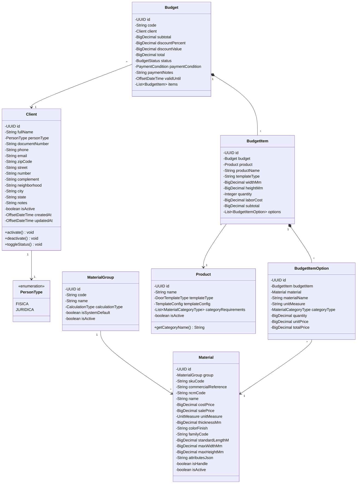
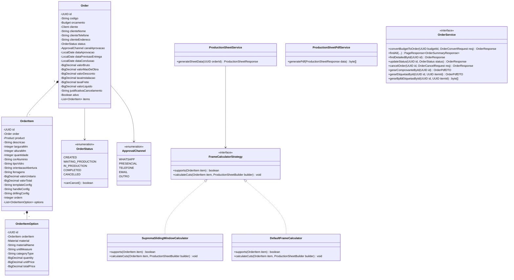
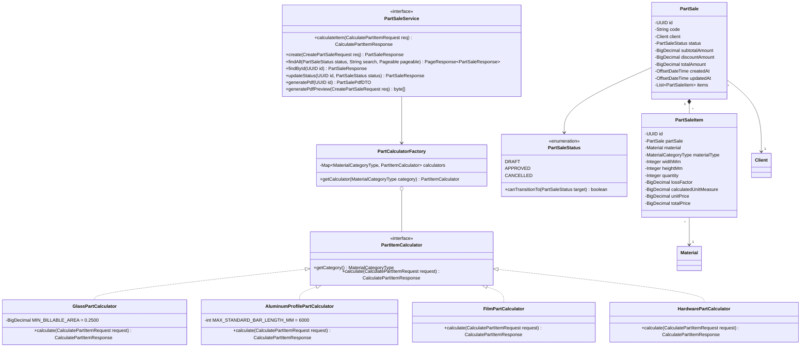
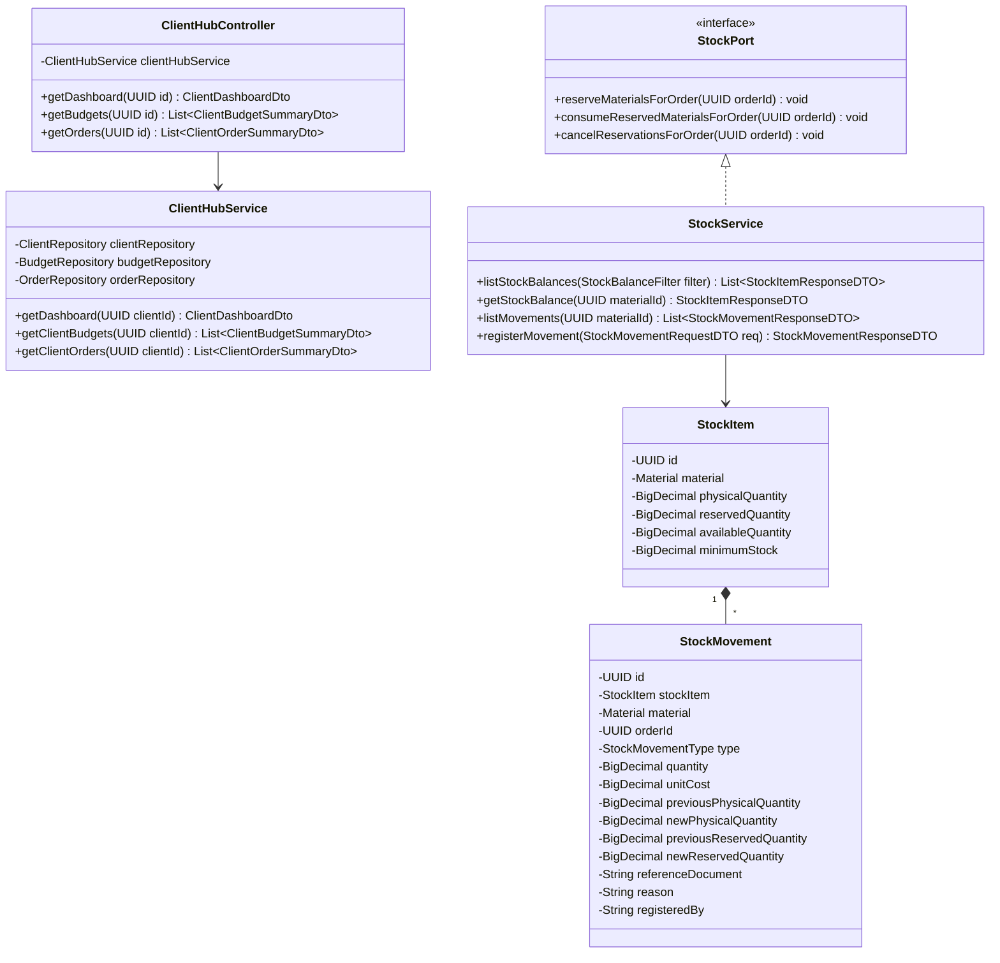
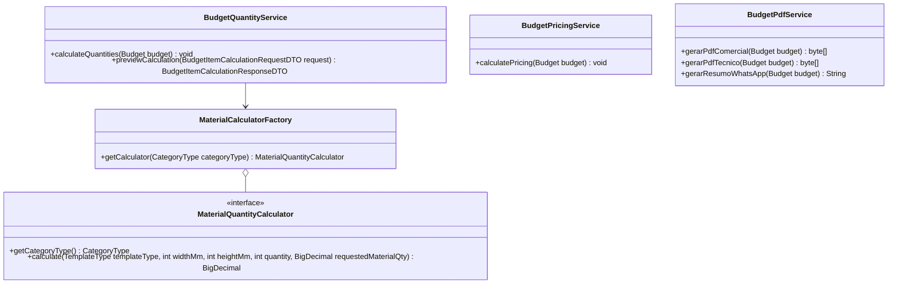

# 🏗️ DCC — Diagramas de Classes do Domínio e Engenharia (AlumiGest)

| Metadado | Descrição |
|---|---|
| **Projeto** | AlumiGest — Sistema de Gestão para Vidraçaria e Esquadrias |
| **Sigla** | ALG |
| **Versão** | 5.0 (Consolidado com Ordens de Serviço, Ficha Técnica, Venda Avulsa, Hub 360° e Prévia Estoque S09) |
| **Data** | 18/11/2026 |
| **Governança** | Docs-as-Code — Oficial de Governança (`alumigest-doc-governor`) |

---

## Histórico de Revisões

| Data | Versão | Descrição | Autor |
|---|---|---|---|
| 05/08/2026 | 1.0 | Versão inicial dos diagramas conceituais | Ítalo Jefferson / Equipe AlumiGest |
| 12/08/2026 | 2.0 | Ajustes de relacionamentos na Sprint 2 | Equipe AlumiGest |
| 31/08/2026 | 3.0 | Atualização preliminar da Sprint 3 com padrões Strategy e UUIDs | Equipe AlumiGest |
| 24/09/2026 | 4.0 | Revisão minuciosa e fiel ao código: `Client`, `Material`, `Product` paramétrico, OpenPDF e DTOs Records | Equipe AlumiGest (Tech Lead: Ítalo Jefferson) |
| 18/11/2026 | 5.0 | Expansão com os pacotes `orders` (O.S., Snapshot, Etiquetas, Kanban, Ficha Técnica), `partsale` (Venda Avulsa Strategy + Factory), `clients` (Hub 360° CQRS) e prévia de `stock` (Sprint 09) | Equipe AlumiGest (Tech Lead: Ítalo Jefferson) |

---

## 1. 🏛️ Modelo de Domínio Base: Clientes, Catálogo e Orçamentos

---

## 2. 📦 Domínio de Ordens de Serviço, Etiquetas e Ficha Técnica (`orders`)

---

## 3. 🛒 Domínio de Venda Avulsa de Partes (`partsale` — US-46)

---

## 4. 👤 Hub 360° do Cliente (`clients` — US-47) & Prévia de Estoque (`stock` — Sprint 09)

---

## 5. 🧮 Motor de Cálculo de Orçamentos & Emissão Documental (`budgets`)

---
*Documento homologado pelo Oficial de Governança Técnica (`alumigest-doc-governor`) em 18/11/2026.*
