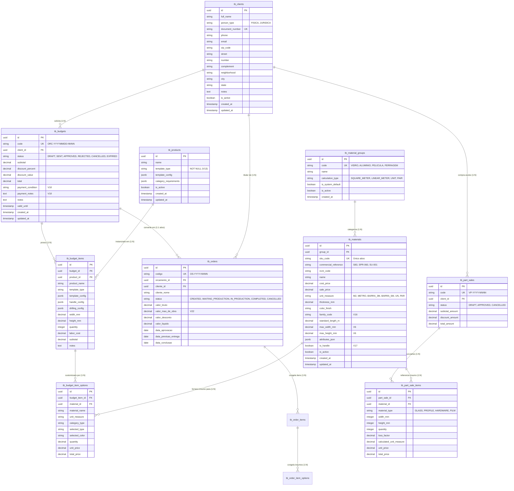

# 📐 Documento de Arquitetura e Modelagem de Dados (DER)
## Módulo: Catálogo de Materiais, Templates, Clientes, Orçamentos, Ordens e Venda Avulsa
**Projeto:** AlumiGest (Gestão Operacional e Orçamentária para Esquadrias e Vidraçaria)  
**Versão:** 5.0.0 (Consolidado com Migrações Flyway V1 a V25 — `release/v0.8.0`)  
**Data:** 18 de Novembro de 2026  
**Autor:** Equipe de Engenharia de Software (Tech Lead: Italo Jefferson Lima dos Santos)  

---

## 1. 🎯 Visão Geral e Objetivos Arquiteturais

O modelo de dados do AlumiGest foi projetado com base em princípios de alta coesão, extensibilidade (*Type-Object Pattern*) e conformidade com a engenharia de fabricação da **Alumiportas**.

### 🌟 Princípios de Design e Modelagem
1. **Grupos Fundamentais de Insumos (Sprint 2 / `V1`, `V6`, `V16`, `V17`):**
   * **Vidros:** Medidos por área ($m^2$), com espessuras de **2mm a 10mm**, dimensões máximas de chapa (`max_width_mm`, `max_height_mm`) e regra de faturamento mínimo de $0,25\text{ m}^2$.
   * **Perfis de Alumínio e Puxadores:** Medidos por metro linear ($m$) com barras padrão de **3.00m** e **6.00m**, referências comerciais (`SU-001`, `S83`, `SPR-060`), agrupamento por família (`family_code` na `V16`), flag explícita de puxador (`is_handle` na `V17`) e NCM.
   * **Películas:** Medidas por área de aplicação ($m^2$) sobre o vidro e largura máxima de bobina (`max_width_mm`).
   * **Ferragens e Componentes:** Medidos por **Unidade (`UN`)**, **Par (`PAR`)** ou **Metro (`METRO`)**.
2. **Templates Paramétricos de Esquadrias (`V8`, `V10`, `V12`, `V13`, `V14`, `V15`):**
   * A entidade `tb_products` atua como receita paramétrica (`DoorTemplateType` obrigatório na `V13`), armazenando esquemas vetoriais e opções permitidas em `template_config` (`JSONB`) e categorias requeridas em `category_requirements` (`JSONB`).
   * As antigas tabelas `tb_product_categories` (`V12`) e `tb_product_items` (`V13`) e a coluna `labor_cost` (`V10`) foram descontinuadas.
3. **Clientes e Orçamentos (`V7`, `V9`, `V18`, `V24`):**
   * Clientes PF/PJ modelados na tabela oficial **`tb_clients`**, incluindo o registro seed padrão `Cliente Balcão (Consumidor Final)` (`V24`).
   * Orçamentos em `tb_budgets`, `tb_budget_items` e `tb_budget_item_options`, acrescidos de `payment_condition` e `payment_notes` (`V18`).
4. **Ordens de Serviço e Venda Avulsa de Partes (`V19`–`V25`):**
   * **Ordens de Serviço (`V19`–`V22`, `V25`):** `tb_orders` (código `OS-YYYY-NNNN` da `V20`, índice parcial `uk_orders_orcamento_ativo` da `V21`, `valor_mao_de_obra` congelado da `V22`, status inicial padrão `CREATED` da `V25`), `tb_order_items` e `tb_order_item_options`.
   * **Venda Avulsa (`V23`, `V24`):** `tb_part_sales` (`VP-YYYY-NNNN`) e `tb_part_sale_items` referenciando diretamente `tb_materials` sem dependência prévia de estoque.

---

## 2. 📊 Diagrama Entidade-Relacionamento (DER Consolidado)



---

## 3. 📑 Dicionário Detalhado das Entidades

### 3.1 `tb_material_groups` (Grupos Fundamentais)
| Campo | Tipo | Restrições | Descrição |
| :--- | :--- | :--- | :--- |
| `id` | `UUID` | `PK, DEFAULT uuid_generate_v4()` | Identificador único universal. |
| `code` | `VARCHAR(50)` | `NOT NULL, UNIQUE` | `VIDRO`, `ALUMINIO`, `PELICULA`, `FERRAGEM`. |
| `name` | `VARCHAR(100)` | `NOT NULL` | Rótulo legível para operadores. |
| `calculation_type` | `VARCHAR(30)` | `NOT NULL` | `SQUARE_METER`, `LINEAR_METER`, `UNIT`, `PAIR`. |
| `description` | `TEXT` | `NULL` | Orientações de engenharia. |
| `is_system_default` | `BOOLEAN` | `NOT NULL, DEFAULT FALSE` | Proteção contra exclusão acidental. |
| `is_active` | `BOOLEAN` | `NOT NULL, DEFAULT TRUE` | Soft delete. |

---

### 3.2 `tb_materials` (Insumos e Matérias-Primas — `V1`, `V3`, `V6`, `V16`, `V17`)
| Campo | Tipo | Restrições | Descrição |
| :--- | :--- | :--- | :--- |
| `id` | `UUID` | `PK, DEFAULT uuid_generate_v4()` | Identificador universal. |
| `group_id` | `UUID` | `NOT NULL, FK -> tb_material_groups(id)` | Chave estrangeira do grupo. |
| `sku_code` | `VARCHAR(50)` | `NULL, UNIQUE WHERE is_active=TRUE` | Código interno SKU (`V6`). |
| `commercial_reference` | `VARCHAR(100)` | `NULL` | Referência de catálogo (`S83`, `SPR-060`, `SU-001`). |
| `ncm_code` | `VARCHAR(10)` | `NULL` | Classificação fiscal NCM. |
| `name` | `VARCHAR(150)` | `NOT NULL` | Nome legível do material. |
| `cost_price` | `DECIMAL(12,2)` | `NOT NULL, DEFAULT 0.00` | Preço de custo de aquisição. |
| `sale_price` | `DECIMAL(12,2)` | `NOT NULL, DEFAULT 0.00` | Preço de venda praticado. |
| `unit_measure` | `VARCHAR(20)` | `NOT NULL, DEFAULT 'UN'` | `M2`, `METRO`, `BARRA_3M`, `BARRA_6M`, `UN`, `PAR`. |
| `thickness_mm` | `DECIMAL(6,2)` | `NULL` | Espessura física em mm (`2.00`, `4.00`, `8.00`). |
| `color_finish` | `VARCHAR(50)` | `NULL` | Acabamento (Incolor, Bronze, Branco Ral, Preto). |
| `family_code` | `VARCHAR(50)` | `NULL` | Código de família comercial para variações de cor/SKU (`V16`). |
| `standard_length_m` | `DECIMAL(6,2)` | `NULL` | Comprimento da barra (`3.00` ou `6.00`). |
| `max_width_mm` | `DECIMAL(10,2)` | `NULL` | Largura máxima de chapa ou bobina (`V6`). |
| `max_height_mm` | `DECIMAL(10,2)` | `NULL` | Altura máxima de chapa (`V6`). |
| `attributes_json` | `JSONB` | `NULL` | Extensões dinâmicas. |
| `is_handle` | `BOOLEAN` | `NOT NULL, DEFAULT FALSE` | Indica explicitamente se o insumo é um puxador/fecho (`V17`). |
| `is_active` | `BOOLEAN` | `NOT NULL, DEFAULT TRUE` | Soft delete. |

---

### 3.3 `tb_products` (Templates de Esquadrias Paramétricas — `V2`, `V8`, `V10`, `V12`, `V13`)
| Campo | Tipo | Restrições | Descrição |
| :--- | :--- | :--- | :--- |
| `id` | `UUID` | `PK` | Identificador universal. |
| `name` | `VARCHAR(150)` | `NOT NULL` | Nome do template (*"Porta de Correr 2 Folhas"*). |
| `template_type` | `VARCHAR(50)` | `NOT NULL` | Enum canônico `DoorTemplateType`. |
| `template_config` | `JSONB` | `NULL` | Puxador, furação técnica, esquema vetorial e `optionSchema`. |
| `category_requirements` | `JSONB` | `NULL` | Insumos requeridos (`["GLASS", "PROFILE", "HARDWARE"]`). |
| `is_active` | `BOOLEAN` | `NOT NULL, DEFAULT TRUE` | Soft delete. |

---

### 3.4 `tb_clients` (Clientes — `V7`, `V24`)
| Campo | Tipo | Restrições | Descrição |
| :--- | :--- | :--- | :--- |
| `id` | `UUID` | `PK, DEFAULT uuid_generate_v4()` | Identificador universal. |
| `full_name` | `VARCHAR(150)` | `NOT NULL` | Nome completo / Razão Social. |
| `person_type` | `VARCHAR(20)` | `NOT NULL, DEFAULT 'FISICA'` | `FISICA` ou `JURIDICA`. |
| `document_number` | `VARCHAR(20)` | `NULL, UNIQUE (parcial não vazio)` | CPF ou CNPJ validado. |
| `phone` | `VARCHAR(20)` | `NULL` | Telefone / WhatsApp de contato. |
| `email` | `VARCHAR(100)` | `NULL` | E-mail de contato comercial. |
| `zip_code` | `VARCHAR(10)` | `NULL` | CEP do endereço. |
| `street`, `number`, `complement`, `neighborhood`, `city`, `state` | `VARCHAR` | `NULL` | Endereço estruturado da obra / entrega. |
| `notes` | `TEXT` | `NULL` | Observações cadastrais. |
| `is_active` | `BOOLEAN` | `NOT NULL, DEFAULT TRUE` | Soft delete. |

---

### 3.5 `tb_budgets`, `tb_budget_items` e `tb_budget_item_options` (`V9`, `V18`)
* **`tb_budgets`:** `id`, `code` (`VARCHAR(50) UNIQUE`), `client_id` (`FK -> tb_clients(id)`), `subtotal`, `discount_percent`, `discount_value`, `total`, `status`, `payment_condition` (`V18`), `payment_notes` (`V18`), `notes`, `valid_until`, `created_at`, `updated_at`.
* **`tb_budget_items`:** `id`, `budget_id`, `product_id`, `product_name`, `template_type`, `template_config`, `handle_config`, `drilling_config`, `width_mm`, `height_mm`, `quantity`, `labor_cost`, `subtotal`, `notes`.
* **`tb_budget_item_options`:** `id`, `budget_item_id`, `material_id`, `material_name`, `unit_measure`, `category_type`, `selected_type`, `selected_color`, `quantity`, `unit_price`, `total_price`.

### 3.6 `tb_orders`, `tb_order_items`, `tb_order_item_options`, `tb_part_sales` e `tb_part_sale_items` (`V19`–`V25`)
* Detalhamento completo de todas as colunas e índices mantido no documento oficial [`MER-Modelo_de_Dados.md`](./MER-Modelo_de_Dados.md).

---

## 4. 🗄️ Script DDL Incremental Consolidado (Migrations `V16` a `V25`)

*(O DDL base de `V1` a `V15` permanece preservado; abaixo constam as evoluções incrementais aplicadas até a `release/v0.8.0`.)*

```sql
-- V16: Família de materiais
ALTER TABLE tb_materials ADD COLUMN IF NOT EXISTS family_code VARCHAR(50);
CREATE INDEX IF NOT EXISTS idx_materials_family_code ON tb_materials(family_code);

-- V17: Identificação explícita de puxadores
ALTER TABLE tb_materials ADD COLUMN IF NOT EXISTS is_handle BOOLEAN NOT NULL DEFAULT FALSE;
CREATE INDEX IF NOT EXISTS idx_materials_is_handle ON tb_materials(is_handle);

-- V18: Condições comerciais em orçamentos
ALTER TABLE tb_budgets
    ADD COLUMN IF NOT EXISTS payment_condition VARCHAR(50),
    ADD COLUMN IF NOT EXISTS payment_notes TEXT;

-- V19, V20, V21, V22, V25: Ordens de Serviço (O.S.) e Snapshot Imutável
CREATE TABLE tb_orders (
    id UUID PRIMARY KEY DEFAULT uuid_generate_v4(),
    codigo VARCHAR(20) NOT NULL UNIQUE,
    orcamento_id UUID NOT NULL REFERENCES tb_budgets (id),
    cliente_id UUID REFERENCES tb_clients (id),
    cliente_nome VARCHAR(200) NOT NULL,
    cliente_telefone VARCHAR(20),
    cliente_endereco TEXT,
    status VARCHAR(25) NOT NULL DEFAULT 'CREATED',
    canal_aprovacao VARCHAR(20) NOT NULL,
    data_aprovacao DATE NOT NULL DEFAULT CURRENT_DATE,
    data_previsao_entrega DATE NOT NULL,
    data_conclusao DATE,
    valor_bruto NUMERIC(12, 2) NOT NULL DEFAULT 0.00,
    valor_mao_de_obra NUMERIC(12, 2) NOT NULL DEFAULT 0.00,
    valor_desconto NUMERIC(12, 2) NOT NULL DEFAULT 0.00,
    taxa_instalacao NUMERIC(12, 2) NOT NULL DEFAULT 0.00,
    taxa_frete NUMERIC(12, 2) NOT NULL DEFAULT 0.00,
    valor_liquido NUMERIC(12, 2) NOT NULL DEFAULT 0.00,
    condicao_pagamento VARCHAR(30),
    observacoes_pagamento TEXT,
    observacoes TEXT,
    justificativa_cancelamento TEXT,
    created_at TIMESTAMP WITH TIME ZONE NOT NULL DEFAULT CURRENT_TIMESTAMP,
    updated_at TIMESTAMP WITH TIME ZONE NOT NULL DEFAULT CURRENT_TIMESTAMP,
    ativo BOOLEAN NOT NULL DEFAULT TRUE
);

CREATE UNIQUE INDEX uk_orders_orcamento_ativo
    ON tb_orders (orcamento_id)
    WHERE status <> 'CANCELLED';

CREATE TABLE tb_order_items (
    id UUID PRIMARY KEY DEFAULT uuid_generate_v4(),
    order_id UUID NOT NULL REFERENCES tb_orders (id) ON DELETE CASCADE,
    product_id UUID REFERENCES tb_products (id),
    descricao VARCHAR(300) NOT NULL,
    largura_mm INTEGER NOT NULL,
    altura_mm INTEGER NOT NULL,
    quantidade INTEGER NOT NULL,
    cor_aluminio VARCHAR(50),
    tipo_vidro VARCHAR(100),
    orientacao_abertura VARCHAR(30),
    ferragens TEXT,
    valor_unitario NUMERIC(12, 2) NOT NULL DEFAULT 0.00,
    valor_total NUMERIC(12, 2) NOT NULL DEFAULT 0.00,
    template_config JSONB,
    handle_config JSONB,
    drilling_config JSONB,
    ordem INTEGER NOT NULL DEFAULT 0
);

CREATE TABLE tb_order_item_options (
    id UUID PRIMARY KEY DEFAULT uuid_generate_v4(),
    order_item_id UUID NOT NULL REFERENCES tb_order_items (id) ON DELETE CASCADE,
    material_id UUID REFERENCES tb_materials (id),
    material_name VARCHAR(150) NOT NULL,
    unit_measure VARCHAR(20) NOT NULL,
    category_type VARCHAR(50) NOT NULL,
    selected_type VARCHAR(100),
    selected_color VARCHAR(50),
    quantity NUMERIC(10, 2) NOT NULL,
    unit_price NUMERIC(12, 2) NOT NULL DEFAULT 0.00,
    total_price NUMERIC(12, 2) NOT NULL DEFAULT 0.00
);

-- V23 e V24: Venda Avulsa de Partes e Seed Cliente Balcão
CREATE TABLE tb_part_sales (
    id UUID PRIMARY KEY DEFAULT gen_random_uuid(),
    code VARCHAR(30) UNIQUE NOT NULL,
    client_id UUID NOT NULL REFERENCES tb_clients(id),
    status VARCHAR(20) NOT NULL,
    subtotal_amount NUMERIC(12, 2) NOT NULL,
    discount_amount NUMERIC(12, 2) DEFAULT 0.00,
    total_amount NUMERIC(12, 2) NOT NULL,
    created_at TIMESTAMP WITH TIME ZONE NOT NULL DEFAULT NOW(),
    updated_at TIMESTAMP WITH TIME ZONE NOT NULL DEFAULT NOW()
);

CREATE TABLE tb_part_sale_items (
    id UUID PRIMARY KEY DEFAULT gen_random_uuid(),
    part_sale_id UUID NOT NULL REFERENCES tb_part_sales(id) ON DELETE CASCADE,
    material_id UUID NOT NULL REFERENCES tb_materials(id),
    material_type VARCHAR(30) NOT NULL,
    width_mm INT NULL,
    height_mm INT NULL,
    quantity INT NOT NULL CHECK (quantity > 0),
    loss_factor NUMERIC(6, 4) NULL,
    calculated_unit_measure NUMERIC(10, 4) NOT NULL,
    unit_price NUMERIC(12, 2) NOT NULL,
    total_price NUMERIC(12, 2) NOT NULL
);
```

---

*Documento de Arquitetura de Dados (DER) homologado com as migrações V1 a V25 — Versão 5.0.0 — 18/11/2026*
