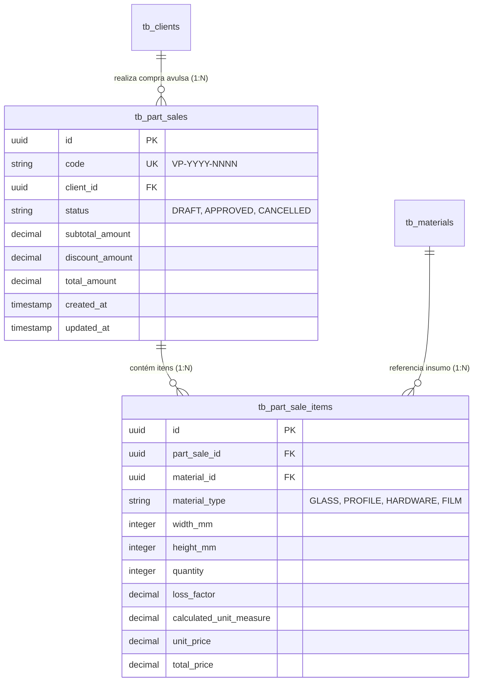

# 📊 MER — Modelo de Dados Oficial (AlumiGest)
**Projeto:** AlumiGest — Sistema de Gestão para Vidraçaria e Esquadrias  
**Versão:** 6.0 (Consolidado com Venda Avulsa de Partes, Ordens de Serviço V1–V25 e Prévia do Módulo de Estoque S09)  
**Data:** 18 de Novembro de 2026  
**SGBD:** PostgreSQL 16 com extensão `uuid-ossp`  
**Autor:** Equipe de Engenharia AlumiGest (Tech Lead: Italo Santos)  

---

## 1. 🎯 Visão Geral da Arquitetura de Dados

O modelo de dados do AlumiGest foi projetado com foco em **extensibilidade universal (*Type-Object Pattern*)**, **templates de esquadrias paramétricas**, **imutabilidade contratual por snapshot** e **rastreabilidade transacional ponta a ponta**.

Principais evoluções estruturais consolidadas nas migrações Flyway **`V1` a `V25`** (branch `release/v0.8.0`) e na especificação do módulo de estoque da Sprint 09:
* **Catálogo e Parametrização (`V1`–`V17`):** As antigas tabelas `tb_product_categories` (`V12`) e `tb_product_items` (`V13`) foram extintas; `tb_products` armazena o esquema paramétrico (`template_config`, contendo inclusive `optionSchema`) e requisitos (`category_requirements`). `tb_materials` recebeu dimensões máximas (`max_width_mm`, `max_height_mm` na `V6`), agrupamento por família/acabamento (`family_code` na `V16`) e indicador explícito de puxador (`is_handle` na `V17`).
* **Clientes e Orçamentos (`V7`, `V9`, `V18`):** Tabela oficial `tb_clients` com suporte a PF/PJ, endereço estruturado e condições comerciais (`payment_condition`, `payment_notes` na `V18`).
* **Ordens de Serviço e Snapshot Imutável (`V19`–`V22`, `V25`):** Criação de `tb_orders`, `tb_order_items` e `tb_order_item_options`, unificação do código para `OS-YYYY-NNNN` (`V20`), reconversão condicional após cancelamento via índice parcial `uk_orders_orcamento_ativo` (`V21`), congelamento explícito de `valor_mao_de_obra` (`V22`) e status inicial padrão `CREATED` (`V25`).
* **Venda Avulsa de Partes — US-46 (`V23`, `V24`):** Criação de `tb_part_sales` e `tb_part_sale_items` com códigos `VP-YYYY-NNNN` e seed determinístico do `Cliente Balcão (Consumidor Final)` (`00000000-0000-0000-0000-000000000001`).
* **Estoque e Kardex — Sprint 09 (`US-21`/`US-22`):** Criação das tabelas `tb_stock_items` e `tb_stock_movements` (com previsão de numeração `V26__create_stock_schema.sql` para evitar colisão com a `V25` da `release/v0.8.0`).

```mermaid
erDiagram
    tb_material_groups ||--o{ tb_materials : "categoriza (1:N)"

    tb_clients ||--o{ tb_budgets : "solicita (1:N)"
    tb_budgets ||--o{ tb_budget_items : "possui (1:N)"
    tb_products ||--o{ tb_budget_items : "instanciado em (1:N)"
    tb_budget_items ||--o{ tb_budget_item_options : "customizado por (1:N)"
    tb_materials ||--o{ tb_budget_item_options : "fornece insumo para (1:N)"

    tb_budgets ||--o{ tb_orders : "origina (1:1 ativo / N se cancelado)"
    tb_clients ||--o{ tb_orders : "titular de (1:N)"
    tb_orders ||--o{ tb_order_items : "contém itens congelados (1:N)"
    tb_products ||--o{ tb_order_items : "referencia template (1:N)"
    tb_order_items ||--o{ tb_order_item_options : "congela insumos (1:N)"
    tb_materials ||--o{ tb_order_item_options : "referencia insumo (1:N)"

    tb_clients ||--o{ tb_part_sales : "adquire avulso (1:N)"
    tb_part_sales ||--o{ tb_part_sale_items : "contém partes (1:N)"
    tb_materials ||--o{ tb_part_sale_items : "precifica insumo (1:N)"

    tb_materials ||--|| tb_stock_items : "mantém saldo (1:1)"
    tb_stock_items ||--o{ tb_stock_movements : "registra Kardex (1:N)"
    tb_materials ||--o{ tb_stock_movements : "movimenta insumo (1:N)"

    tb_material_groups {
        uuid id PK
        string code UK "VIDRO, ALUMINIO, PELICULA, FERRAGEM"
        string name "Nome legível"
        string calculation_type "SQUARE_METER, LINEAR_METER, UNIT, PAIR"
        string description
        boolean is_system_default
        boolean is_active
        timestamp created_at
    }

    tb_materials {
        uuid id PK
        uuid group_id FK
        string sku_code UK "Único quando is_active=true"
        string commercial_reference "S83, SU-001, SPR-060"
        string ncm_code
        string name
        decimal cost_price
        decimal sale_price
        string unit_measure "M2, METRO, BARRA_3M, BARRA_6M, UN, PAR"
        decimal thickness_mm
        string color_finish
        string family_code "V16: agrupamento por linha/família"
        decimal standard_length_m "3.00 ou 6.00"
        decimal max_width_mm "V6: largura máxima da chapa/bobina"
        decimal max_height_mm "V6: altura máxima da chapa"
        jsonb attributes_json
        boolean is_handle "V17: identificador explícito de puxador"
        boolean is_active
        timestamp created_at
        timestamp updated_at
    }

    tb_products {
        uuid id PK
        string name
        string template_type "DoorTemplateType (NOT NULL V13)"
        jsonb template_config "Esquema vetorial e optionSchema"
        jsonb category_requirements "GLASS, PROFILE, HARDWARE, FILM"
        boolean is_active
        timestamp created_at
        timestamp updated_at
    }

    tb_clients {
        uuid id PK
        string full_name
        string person_type "FISICA, JURIDICA"
        string document_number UK "Parcial quando preenchido"
        string phone
        string email
        string zip_code
        string street
        string number
        string complement
        string neighborhood
        string city
        string state
        text notes
        boolean is_active
        timestamp created_at
        timestamp updated_at
    }

    tb_budgets {
        uuid id PK
        string code UK "ORC-YYYYMMDD-NNNN"
        uuid client_id FK
        string status "DRAFT, SENT, APPROVED, REJECTED, CANCELLED, EXPIRED"
        decimal subtotal
        decimal discount_percent
        decimal discount_value
        decimal total
        string payment_condition "V18: PaymentCondition"
        text payment_notes "V18: observações comerciais"
        text notes
        timestamp valid_until
        timestamp created_at
        timestamp updated_at
    }

    tb_budget_items {
        uuid id PK
        uuid budget_id FK
        uuid product_id FK
        string product_name
        string template_type
        jsonb template_config
        jsonb handle_config
        jsonb drilling_config
        decimal width_mm
        decimal height_mm
        integer quantity
        decimal labor_cost
        decimal subtotal
        text notes
    }

    tb_budget_item_options {
        uuid id PK
        uuid budget_item_id FK
        uuid material_id FK
        string material_name
        string unit_measure
        string category_type "GLASS, PROFILE, HARDWARE, FILM"
        string selected_type
        string selected_color
        decimal quantity
        decimal unit_price
        decimal total_price
    }

    tb_orders {
        uuid id PK
        string codigo UK "OS-YYYY-NNNN (V20)"
        uuid orcamento_id FK "Único ativo via uk_orders_orcamento_ativo (V21)"
        uuid cliente_id FK
        string cliente_nome
        string cliente_telefone
        text cliente_endereco
        string status "CREATED (default V25), WAITING_PRODUCTION, IN_PRODUCTION, COMPLETED, CANCELLED"
        string canal_aprovacao "WHATSAPP, PRESENCIAL, TELEFONE, EMAIL, OUTRO"
        date data_aprovacao
        date data_previsao_entrega
        date data_conclusao
        decimal valor_bruto
        decimal valor_mao_de_obra "V22: congelado no pedido"
        decimal valor_desconto
        decimal taxa_instalacao
        decimal taxa_frete
        decimal valor_liquido
        string condicao_pagamento
        text observacoes_pagamento
        text observacoes
        text justificativa_cancelamento
        boolean ativo
        timestamp created_at
        timestamp updated_at
    }

    tb_order_items {
        uuid id PK
        uuid order_id FK
        uuid product_id FK
        string descricao
        integer largura_mm
        integer altura_mm
        integer quantidade
        string cor_aluminio
        string tipo_vidro
        string orientacao_abertura
        text ferragens
        decimal valor_unitario
        decimal valor_total
        jsonb template_config
        jsonb handle_config
        jsonb drilling_config
        integer ordem
    }

    tb_order_item_options {
        uuid id PK
        uuid order_item_id FK
        uuid material_id FK
        string material_name
        string unit_measure
        string category_type
        string selected_type
        string selected_color
        decimal quantity
        decimal unit_price
        decimal total_price
    }

    tb_part_sales {
        uuid id PK
        string code UK "VP-YYYY-NNNN"
        uuid client_id FK "Default: Cliente Balcão V24"
        string status "DRAFT, APPROVED, CANCELLED"
        decimal subtotal_amount
        decimal discount_amount
        decimal total_amount
        timestamp created_at
        timestamp updated_at
    }

    tb_part_sale_items {
        uuid id PK
        uuid part_sale_id FK
        uuid material_id FK
        string material_type "GLASS, PROFILE, HARDWARE, FILM"
        integer width_mm "Nullable (Ferragem/Alumínio)"
        integer height_mm "Nullable (Ferragem)"
        integer quantity
        decimal loss_factor "Escala 4 casas"
        decimal calculated_unit_measure "Área m², metros ou unidades"
        decimal unit_price
        decimal total_price
    }

    tb_stock_items {
        uuid id PK
        uuid material_id UK_FK
        decimal physical_quantity "Saldo físico real"
        decimal reserved_quantity "Saldo reservado por O.S."
        decimal available_quantity "physical - reserved"
        decimal minimum_stock "Ponto de pedido"
        timestamp created_at
        timestamp updated_at
    }

    tb_stock_movements {
        uuid id PK
        uuid stock_item_id FK
        uuid material_id FK
        uuid order_id "Nullable"
        string type "StockMovementType"
        decimal quantity "Sempre > 0"
        decimal unit_cost "Custo aquisição"
        decimal previous_physical_quantity
        decimal new_physical_quantity
        decimal previous_reserved_quantity
        decimal new_reserved_quantity
        string reference_document
        text reason
        string registered_by
        timestamp created_at
    }
```

---

## 2. 🗄️ Dicionário das Tabelas Principais

### 2.1 `tb_material_groups` (Grupos de Insumos — `V1`)
* **Finalidade:** Define os 4 grupos nativos da Alumiportas (`VIDRO`, `ALUMINIO`, `PELICULA`, `FERRAGEM`) e a estratégia de quantificação.
* **Colunas:** `id` (`UUID PK`), `code` (`VARCHAR(50) UNIQUE NOT NULL`), `name` (`VARCHAR(100) NOT NULL`), `calculation_type` (`VARCHAR(30) NOT NULL`), `description` (`TEXT`), `is_system_default` (`BOOLEAN NOT NULL DEFAULT FALSE`), `is_active` (`BOOLEAN NOT NULL DEFAULT TRUE`), `created_at` (`TIMESTAMP WITH TIME ZONE`).

### 2.2 `tb_materials` (Insumos e Matérias-Primas do Catálogo — `V1`, `V3`, `V6`, `V16`, `V17`)
* **Finalidade:** Tabela universal para vidros, perfis de alumínio, películas e ferragens.
* **Colunas:** `id` (`UUID PK`), `group_id` (`UUID FK -> tb_material_groups(id)`), `sku_code` (`VARCHAR(50)`, único parcial ativo `idx_materials_sku_active`), `commercial_reference` (`VARCHAR(100)`), `ncm_code` (`VARCHAR(10)`), `name` (`VARCHAR(150) NOT NULL`), `cost_price` (`DECIMAL(12,2)`), `sale_price` (`DECIMAL(12,2)`), `unit_measure` (`VARCHAR(20)`), `thickness_mm` (`DECIMAL(6,2)`), `color_finish` (`VARCHAR(50)`), `family_code` (`VARCHAR(50)` — `V16`), `standard_length_m` (`DECIMAL(6,2)`), `max_width_mm` (`DECIMAL(10,2)` — `V6`), `max_height_mm` (`DECIMAL(10,2)` — `V6`), `attributes_json` (`JSONB`), `is_handle` (`BOOLEAN NOT NULL DEFAULT FALSE` — `V17`), `is_active` (`BOOLEAN NOT NULL DEFAULT TRUE`), `created_at`, `updated_at`.
* **Índices relevantes:** `idx_materials_group_id`, `idx_materials_name`, `idx_materials_commercial_ref`, `idx_materials_active`, `idx_materials_sku_active`, `idx_materials_family_code` (`V16`), `idx_materials_is_handle` (`V17`).

### 2.3 `tb_products` (Templates Paramétricos de Esquadrias — `V2`, `V8`, `V10`, `V12`, `V13`, `V14`)
* **Finalidade:** Modelagem de receitas/templates de esquadrias (`DoorTemplateType`), esquemas paramétricos vetoriais e limites (`template_config` JSONB) e requisitos dinâmicos de categorias (`category_requirements` JSONB).
* **Colunas:** `id` (`UUID PK`), `name` (`VARCHAR(150) NOT NULL`), `template_type` (`VARCHAR(50) NOT NULL`), `template_config` (`JSONB`), `category_requirements` (`JSONB`), `is_active` (`BOOLEAN NOT NULL`), `created_at`, `updated_at`.
* *Nota Histórica:* A antiga coluna `labor_cost` foi removida na `V10`; `category_id` e `tb_product_categories` foram removidos na `V12`; `tb_product_items` foi removida na `V13`.

### 2.4 `tb_clients` (Clientes — `V7`, `V24`)
* **Finalidade:** Gestão de clientes Pessoa Física (`FISICA`) e Jurídica (`JURIDICA`) para orçamentos, ordens de serviço, vendas avulsas e Central 360° (`US-47`).
* **Colunas:** `id` (`UUID PK`), `full_name` (`VARCHAR(150) NOT NULL`), `person_type` (`VARCHAR(20) NOT NULL DEFAULT 'FISICA'`), `document_number` (`VARCHAR(20)`), `phone` (`VARCHAR(20)`), `email` (`VARCHAR(100)`), `zip_code` (`VARCHAR(10)`), `street` (`VARCHAR(150)`), `number` (`VARCHAR(20)`), `complement` (`VARCHAR(100)`), `neighborhood` (`VARCHAR(100)`), `city` (`VARCHAR(100)`), `state` (`VARCHAR(2)`), `notes` (`TEXT`), `is_active` (`BOOLEAN NOT NULL DEFAULT TRUE`), `created_at`, `updated_at`.
* **Índices e Seed:** Índice único parcial `idx_clients_document_number` (`WHERE document_number IS NOT NULL AND document_number <> ''`). A migração `V24` garante o registro padrão `Cliente Balcão (Consumidor Final)` (`00000000-0000-0000-0000-000000000001`).

### 2.5 `tb_budgets`, `tb_budget_items` & `tb_budget_item_options` (`V9`, `V18`)
* **`tb_budgets`:** Cabeçalho da proposta comercial (`id`, `code` `VARCHAR(50) UNIQUE`, `client_id` `FK -> tb_clients(id)`, `subtotal`, `discount_percent`, `discount_value`, `total`, `status`, `payment_condition` `V18`, `payment_notes` `V18`, `notes`, `valid_until`, `created_at`, `updated_at`).
* **`tb_budget_items`:** Itens de esquadria do orçamento (`id`, `budget_id` `FK ON DELETE CASCADE`, `product_id` `FK -> tb_products(id)`, `product_name`, `template_type`, `template_config` `JSONB`, `handle_config` `JSONB`, `drilling_config` `JSONB`, `width_mm` `NUMERIC(8,2)`, `height_mm` `NUMERIC(8,2)`, `quantity`, `labor_cost`, `subtotal`, `notes`).
* **`tb_budget_item_options`:** Insumos selecionados por item (`id`, `budget_item_id` `FK ON DELETE CASCADE`, `material_id` `FK -> tb_materials(id)`, `material_name`, `unit_measure`, `category_type`, `selected_type`, `selected_color`, `quantity` `NUMERIC(10,2)`, `unit_price`, `total_price`).

### 2.6 `tb_orders`, `tb_order_items` & `tb_order_item_options` (Ordens de Serviço — `V19`, `V20`, `V21`, `V22`, `V25`)
* **Finalidade:** Formalização contratual da venda e ordem executiva fabril com *deep copy* imutável (lock de preços e medidas).
* **`tb_orders`:**
  * `id` (`UUID PK`), `codigo` (`VARCHAR(20) UNIQUE NOT NULL`, padrão `OS-YYYY-NNNN` unificado na `V20`), `orcamento_id` (`UUID NOT NULL FK -> tb_budgets(id)`), `cliente_id` (`UUID FK -> tb_clients(id)`), `cliente_nome` (`VARCHAR(200) NOT NULL`), `cliente_telefone` (`VARCHAR(20)`), `cliente_endereco` (`TEXT`).
  * `status` (`VARCHAR(25) NOT NULL DEFAULT 'CREATED'` conforme `V25`: `CREATED`, `WAITING_PRODUCTION`, `IN_PRODUCTION`, `COMPLETED`, `CANCELLED`), `canal_aprovacao` (`VARCHAR(20)`), `data_aprovacao` (`DATE`), `data_previsao_entrega` (`DATE`), `data_conclusao` (`DATE`).
  * Financeiro congelado: `valor_bruto` (`NUMERIC(12,2)`), `valor_mao_de_obra` (`NUMERIC(12,2) NOT NULL DEFAULT 0.00` — `V22`), `valor_desconto`, `taxa_instalacao`, `taxa_frete`, `valor_liquido`, `condicao_pagamento`, `observacoes_pagamento`, `observacoes`, `justificativa_cancelamento`, `created_at`, `updated_at`, `ativo` (`BOOLEAN`).
  * **Restrição de unicidade ativa (`V21`):** `CREATE UNIQUE INDEX uk_orders_orcamento_ativo ON tb_orders (orcamento_id) WHERE status <> 'CANCELLED'` (permite reconversão caso a O.S. anterior tenha sido cancelada).
* **`tb_order_items`:** `id`, `order_id` (`FK ON DELETE CASCADE`), `product_id` (`FK -> tb_products(id)`), `descricao` (`VARCHAR(300)`), `largura_mm` (`INTEGER`), `altura_mm` (`INTEGER`), `quantidade` (`INTEGER`), `cor_aluminio`, `tipo_vidro`, `orientacao_abertura`, `ferragens`, `valor_unitario`, `valor_total`, `template_config` (`JSONB`), `handle_config` (`JSONB`), `drilling_config` (`JSONB`), `ordem` (`INTEGER`).
* **`tb_order_item_options`:** `id`, `order_item_id` (`FK ON DELETE CASCADE`), `material_id` (`FK -> tb_materials(id)`), `material_name`, `unit_measure`, `category_type`, `selected_type`, `selected_color`, `quantity` (`NUMERIC(10,2)`), `unit_price`, `total_price`.

---

## 3. 🛒 Módulo de Venda Avulsa de Partes (`V23`, `V24` — US-46)

### 3.1 `tb_part_sales` (Cabeçalho de Venda Avulsa)

Armazena propostas e vendas diretas de insumos sem composição de esquadria completa (`VP-YYYY-NNNN`), vinculadas a um cliente cadastrado ou ao `Cliente Balcão` padrão (`V24`).

#### Diagrama de Relacionamento


#### Dicionário de Colunas e Tipos — `tb_part_sales`

| Coluna | Tipo PostgreSQL | Restrições | Descrição Negocial |
|---|---|---|---|
| `id` | `UUID` | `PK, DEFAULT gen_random_uuid()` | Identificador único da venda avulsa. |
| `code` | `VARCHAR(30)` | `UNIQUE, NOT NULL` | Código sequencial anual (`VP-YYYY-NNNN`). |
| `client_id` | `UUID` | `NOT NULL, FK -> tb_clients(id)` | Cliente comprador (ou `Cliente Balcão` seed `V24`). |
| `status` | `VARCHAR(20)` | `NOT NULL` | Ciclo comercial: `DRAFT`, `APPROVED`, `CANCELLED`. |
| `subtotal_amount` | `NUMERIC(12, 2)` | `NOT NULL` | Somatório bruto dos itens em R$. |
| `discount_amount` | `NUMERIC(12, 2)` | `DEFAULT 0.00` | Desconto financeiro aplicado em R$. |
| `total_amount` | `NUMERIC(12, 2)` | `NOT NULL` | Valor líquido final da venda avulsa. |
| `created_at` | `TIMESTAMP WITH TIME ZONE` | `NOT NULL, DEFAULT NOW()` | Data/hora de criação em UTC. |
| `updated_at` | `TIMESTAMP WITH TIME ZONE` | `NOT NULL, DEFAULT NOW()` | Data/hora da última atualização em UTC. |

### 3.2 `tb_part_sale_items` (Itens Avulsos da Venda)

| Coluna | Tipo PostgreSQL | Restrições | Descrição Negocial |
|---|---|---|---|
| `id` | `UUID` | `PK, DEFAULT gen_random_uuid()` | Identificador único do item avulso. |
| `part_sale_id` | `UUID` | `NOT NULL, FK -> tb_part_sales(id) ON DELETE CASCADE` | Vínculo com o cabeçalho da venda avulsa. |
| `material_id` | `UUID` | `NOT NULL, FK -> tb_materials(id)` | Referência ao insumo selecionado no catálogo. |
| `material_type` | `VARCHAR(30)` | `NOT NULL` | Categoria de cálculo: `GLASS`, `PROFILE`, `HARDWARE`, `FILM`. |
| `width_mm` | `INTEGER` | `NULL` | Largura em mm (obrigatória para `GLASS` e `FILM`; nula para `HARDWARE` e `PROFILE`). |
| `height_mm` | `INTEGER` | `NULL` | Altura/comprimento em mm (`GLASS`, `FILM`, `PROFILE`; nula para `HARDWARE`). |
| `quantity` | `INTEGER` | `NOT NULL, CHECK (quantity > 0)` | Quantidade física de peças/barras/unidades. |
| `loss_factor` | `NUMERIC(6, 4)` | `NULL` | Fator proporcional de perda de corte/bobina. |
| `calculated_unit_measure` | `NUMERIC(10, 4)` | `NOT NULL` | Medida faturável apurada pela Strategy (m², metros ou unidades). |
| `unit_price` | `NUMERIC(12, 2)` | `NOT NULL` | Preço unitário congelado do item. |
| `total_price` | `NUMERIC(12, 2)` | `NOT NULL` | Valor total calculado do item. |

#### Índices de `tb_part_sales` e `tb_part_sale_items`
```sql
CREATE INDEX idx_part_sales_client ON tb_part_sales(client_id);
CREATE INDEX idx_part_sales_status ON tb_part_sales(status);
CREATE INDEX idx_part_sale_items_sale ON tb_part_sale_items(part_sale_id);
```

---

## 4. 📦 Módulo de Estoque & Trilha Kardex (Sprint 09 — Em Integração)

> [!WARNING]
> **Nota de Governança Flyway (`V25` vs `V26`):** Na `release/v0.8.0`, a versão `V25` já foi ocupada por `V25__set_default_order_status_created.sql`. Nas branches em desenvolvimento da Sprint 09 (`feat/us-21*`, `feat/us-22*`), o schema de estoque encontra-se provisoriamente como `V25__create_stock_schema.sql`, devendo ser renomeado para **`V26__create_stock_schema.sql`** antes do merge em `develop`.

### 4.1 `tb_stock_items` (Posição Consolidada de Estoque — 1:1 com `tb_materials`)

Mantém o saldo físico real, o volume reservado por Ordens de Serviço e o saldo disponível segundo a invariante Make-to-Order: `available_quantity = physical_quantity - reserved_quantity` (admitindo `available_quantity < 0` para sinalizar necessidade líquida de compras).

#### Diagrama de Relacionamento
```mermaid
erDiagram
    tb_materials ||--|| tb_stock_items : "controla saldo (1:1)"
    tb_stock_items ||--o{ tb_stock_movements : "gera extrato Kardex (1:N)"
    tb_materials ||--o{ tb_stock_movements : "rastreia material (1:N)"

    tb_stock_items {
        uuid id PK
        uuid material_id UK_FK
        decimal physical_quantity "NUMERIC(14,4)"
        decimal reserved_quantity "NUMERIC(14,4) >= 0"
        decimal available_quantity "NUMERIC(14,4)"
        decimal minimum_stock "NUMERIC(14,4) >= 0"
        timestamp created_at
        timestamp updated_at
    }

    tb_stock_movements {
        uuid id PK
        uuid stock_item_id FK
        uuid material_id FK
        uuid order_id "O.S. vinculada (opcional)"
        string type "StockMovementType"
        decimal quantity "NUMERIC(14,4) > 0"
        decimal unit_cost "NUMERIC(12,2)"
        decimal previous_physical_quantity "NUMERIC(14,4)"
        decimal new_physical_quantity "NUMERIC(14,4)"
        decimal previous_reserved_quantity "NUMERIC(14,4)"
        decimal new_reserved_quantity "NUMERIC(14,4)"
        string reference_document
        text reason
        string registered_by
        timestamp created_at
    }
```

#### Dicionário de Colunas e Tipos — `tb_stock_items`

| Coluna | Tipo PostgreSQL | Restrições | Descrição Negocial |
|---|---|---|---|
| `id` | `UUID` | `PK, DEFAULT uuid_generate_v4()` | Identificador do registro de estoque. |
| `material_id` | `UUID` | `NOT NULL, UNIQUE, FK -> tb_materials(id) ON DELETE RESTRICT` | Vínculo 1:1 com o insumo do catálogo. |
| `physical_quantity` | `NUMERIC(14, 4)` | `NOT NULL, DEFAULT 0.0000` | Quantidade física presente no almoxarifado. |
| `reserved_quantity` | `NUMERIC(14, 4)` | `NOT NULL, DEFAULT 0.0000, CHECK (>= 0)` | Quantidade empenhada por O.S. aprovadas/em produção. |
| `available_quantity` | `NUMERIC(14, 4)` | `NOT NULL, DEFAULT 0.0000` | Saldo líquido disponível (`physical - reserved`; negativo indica falta para compra). |
| `minimum_stock` | `NUMERIC(14, 4)` | `NOT NULL, DEFAULT 0.0000, CHECK (>= 0)` | Estoque mínimo para alerta de ponto de pedido. |
| `created_at` | `TIMESTAMP WITH TIME ZONE` | `NOT NULL, DEFAULT CURRENT_TIMESTAMP` | Data de criação em UTC. |
| `updated_at` | `TIMESTAMP WITH TIME ZONE` | `NOT NULL, DEFAULT CURRENT_TIMESTAMP` | Data da última movimentação em UTC. |

### 4.2 `tb_stock_movements` (Trilha Imutável de Auditoria Kardex — Append-Only)

| Coluna | Tipo PostgreSQL | Restrições | Descrição Negocial |
|---|---|---|---|
| `id` | `UUID` | `PK, DEFAULT uuid_generate_v4()` | Identificador único do lançamento Kardex. |
| `stock_item_id` | `UUID` | `NOT NULL, FK -> tb_stock_items(id) ON DELETE RESTRICT` | Referência ao saldo consolidado do insumo. |
| `material_id` | `UUID` | `NOT NULL, FK -> tb_materials(id) ON DELETE RESTRICT` | Referência direta ao material movimentado. |
| `order_id` | `UUID` | `NULL` | Identificador da Ordem de Serviço originadora (quando aplicável). |
| `type` | `VARCHAR(40)` | `NOT NULL` | Tipo da movimentação (`StockMovementType`). |
| `quantity` | `NUMERIC(14, 4)` | `NOT NULL, CHECK (quantity > 0)` | Quantidade absoluta movimentada. |
| `unit_cost` | `NUMERIC(12, 2)` | `NULL` | Custo unitário de aquisição informado em entradas de compra. |
| `previous_physical_quantity` | `NUMERIC(14, 4)` | `NOT NULL` | Saldo físico imediatamente anterior à operação. |
| `new_physical_quantity` | `NUMERIC(14, 4)` | `NOT NULL` | Saldo físico imediatamente posterior à operação. |
| `previous_reserved_quantity` | `NUMERIC(14, 4)` | `NOT NULL` | Saldo reservado imediatamente anterior à operação. |
| `new_reserved_quantity` | `NUMERIC(14, 4)` | `NOT NULL` | Saldo reservado imediatamente posterior à operação. |
| `reference_document` | `VARCHAR(100)` | `NULL` | Documento de referência em texto livre (NF, recibo, O.S.). |
| `reason` | `TEXT` | `NULL` | Motivo/justificativa da movimentação ou perda. |
| `registered_by` | `VARCHAR(150)` | `NULL` | Operador responsável pelo lançamento. |
| `created_at` | `TIMESTAMP WITH TIME ZONE` | `NOT NULL, DEFAULT CURRENT_TIMESTAMP` | Timestamp imutável da movimentação em UTC. |

#### Índices do Módulo de Estoque
```sql
CREATE INDEX idx_stock_items_material_id ON tb_stock_items (material_id);
CREATE INDEX idx_stock_items_available_quantity ON tb_stock_items (available_quantity);

CREATE INDEX idx_stock_movements_stock_item_id ON tb_stock_movements (stock_item_id);
CREATE INDEX idx_stock_movements_material_created ON tb_stock_movements (material_id, created_at DESC);
CREATE INDEX idx_stock_movements_order_type ON tb_stock_movements (order_id, type);
```

---

*Modelo de Dados homologado com a base PostgreSQL 16 (Flyway V1–V25 + prévia V26 Estoque) — Versão 6.0 — 18/11/2026*
